# E02 · Llenguatge visual del terreny

**Estat:** decidit i integrat al prototip de M2; la variant realista no s'ha construït · **Data:** 2026-11-10 · **Decisió:** cartogràfic amb color

## Pregunta

Realista, cartogràfic o híbrid?

## Opcions provades

La mateixa ruta (Calonge, terreny d'E01), amb Three.js 0.187 (`WebGPURenderer` i shaders en TSL).

| | Vista general | Seguiment |
|---|---|---|
| **Cartogràfic amb color** | 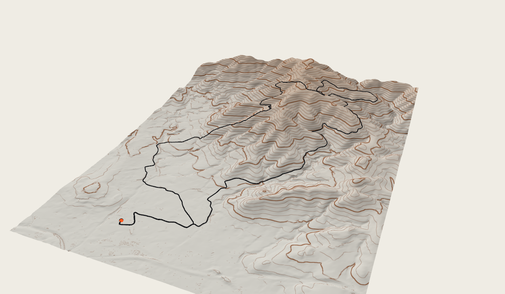 | 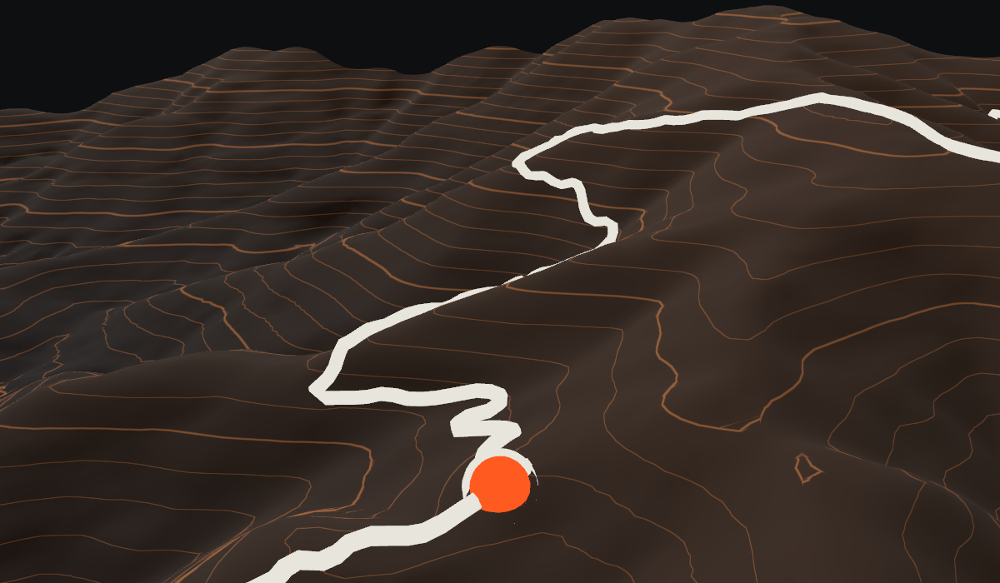 |
| Paper (només línies) | 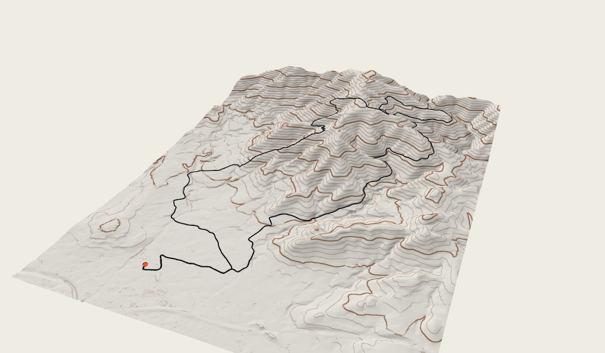 | 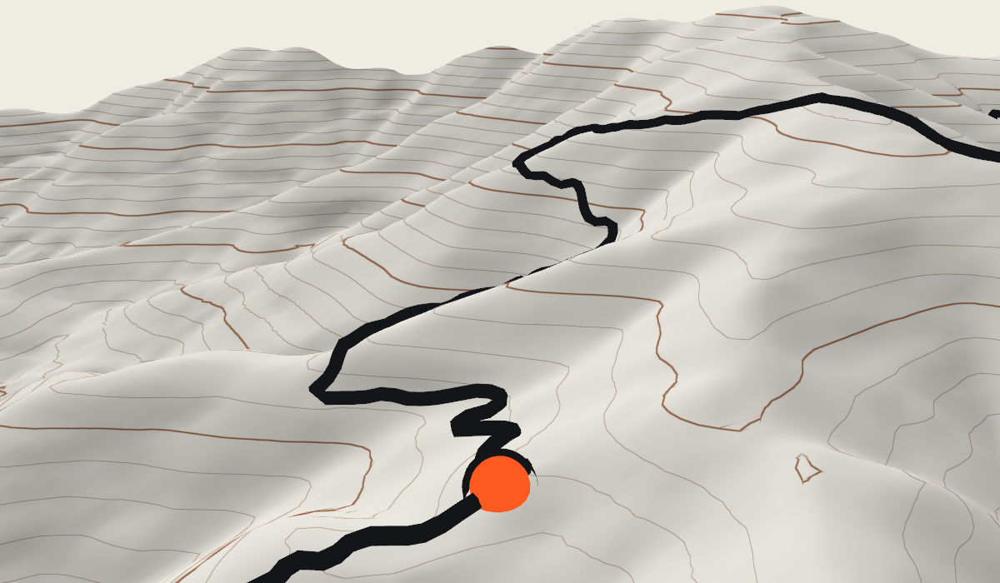 |

- **Cartogràfic amb color:** tinta hipsomètrica, ombrejat del relleu amb la llum des del nord-oest i corbes de nivell cada 10 m (mestres cada 50 m), dibuixades al shader.
- **Paper:** el mateix sense la tinta, amb el terreny del color de la superfície.

El lliurable demanava tres versions. La realista (ortofoto) no s'ha fet: la hipòtesi de CLAUDE.md la deixava com a capa opcional i queda per a més endavant.

## Decisió

**Cartogràfic amb color**, triat sobre les captures. El relleu es llegeix millor amb la tinta que amb les línies soles, i no s'assembla a un visor de satèl·lit.

Tots els colors surten dels tokens (`@tram/design-system/three`), de manera que el mode nit i els modes niats funcionen sense codi propi:

| Element | Token |
|---|---|
| Fons | `sys.surface` |
| Terreny baix | `sys.surface.alt` |
| Terreny alt | `sys.surface.alt`, un 30 % cap a `sys.map.contour` |
| Corbes de nivell | `sys.map.contour` |
| Traçat per recórrer | `sys.data.grade.1` a `.4`, segons el pendent (E09) |
| Traçat recorregut | `sys.data.primary` |
| Punt actiu i el seu contorn | `sys.data.active` i `sys.data.active.outline` (E09) |

## Com queda a M2

| | Clar | Nit |
|---|---|---|
| Escriptori | 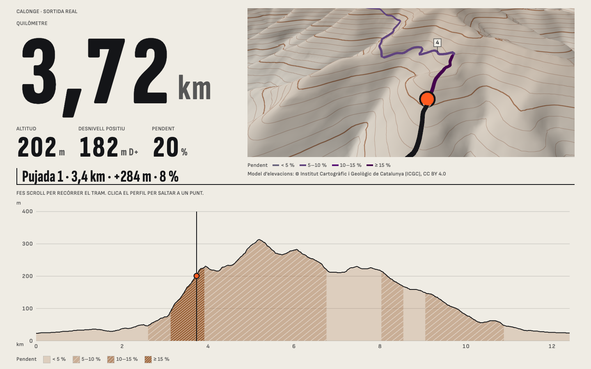 | 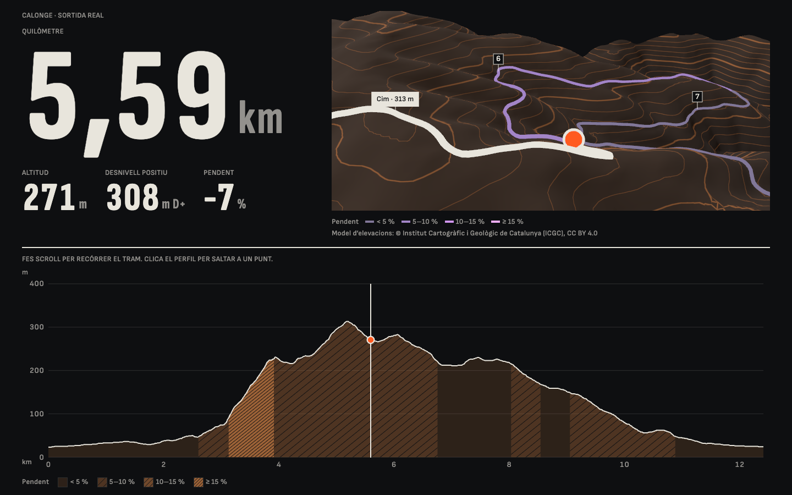 |
| Mòbil | 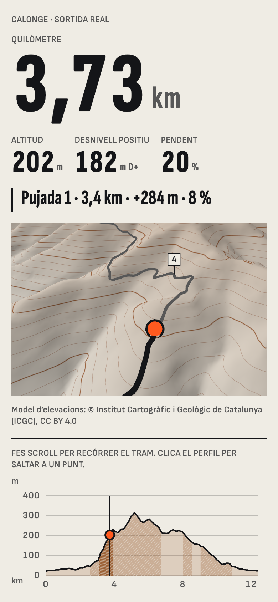 | 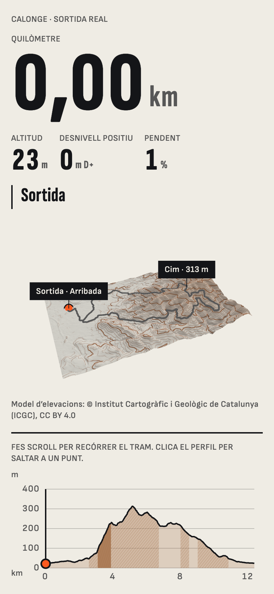 |

- **La càmera segueix el scroll.** A la sortida i a l'arribada mostra tot el recorregut; entremig vola darrere del punt, 420 m enrere i 260 m amunt.
- **Només dibuixa quan canvia la posició.** Aturat no gasta res.
- **Fletxes del teclat:** avancen i retrocedeixen un quilòmetre, i ho anuncien.
- **Perfil i 3D assenyalen el mateix punt, en tots dos sentits.** Passar pel perfil marca aquell lloc al relleu amb un punt buit; passar pel traçat del 3D mou el cursor del perfil, i un clic o un toc hi porta el recorregut.
- **El traçat diu el pendent.** El que queda per córrer va en l'escala lila d'E09, més fosc i més gruixut com més pendent, amb la seva llegenda. El que ja s'ha corregut queda en tinta.
- **Fites sobre el relleu:** sortida, arribada i cim sempre; les de quilòmetre, només a menys d'1,8 km de la càmera. Totes es calculen de les dades i s'amaguen quan el terreny les tapa. Són HTML sobre el llenç, amb la tipografia i els colors dels tokens.
- **Sense moviment automàtic** amb `prefers-reduced-motion` o estalvi de dades: la silueta es queda de pòster i el 3D espera el botó.
- **Sense JavaScript** la pàgina és la mateixa fitxa estàtica d'abans.
- **El recorregut es pot saltar:** un enllaç sota el visor porta directament al que ve després.
- **Exageració vertical:** × 1,5, configurable d'× 1 a × 2,5.
- **Atribució visible:** "Model d'elevacions: © Institut Cartogràfic i Geològic de Catalunya (ICGC), CC BY 4.0".

## Pes

| Peça | Pes |
|---|---|
| Illa 3D: Three.js, escena i traçat | 233,7 KB gzip (189,3 KB Brotli). Pressupost: 250 KB |
| Terreny (`terrain.webp`) | 62,9 KB |
| JS de la pàgina abans del 3D | 0,9 KB gzip, més el dels components |

L'illa es carrega en diferit, quan el visor és visible i el navegador està lliure. Amb només WebGL 2 (sense `WebGPURenderer`) el paquet faria uns 138 KB gzip; es manté el renderer de CLAUDE.md fins que E04 ho decideixi.

## Proves

**Dispositiu real (2026-11-11):** Chrome en un Samsung Galaxy S25, a staging, en mode nit, amb un vídeo de 23 s de tot el recorregut. Va fluid i es veu bé, segons qui ho va provar; no hi ha cap mesura de fotogrames. És un mòbil de gamma alta del 2025, lluny dels dispositius de referència d'E04.

La mateixa prova va trobar un problema d'ús: per arribar al que hi ha sota calia fer tot el recorregut amb el scroll. Ara hi ha l'enllaç "Salta el recorregut", sempre visible. Queda oberta la sensació que el conjunt "és estrany": no s'ha concretat si és la durada del recorregut, la pantalla fixa o una altra cosa.

Chromium amb renderitzat per programari: WebGL 2 i WebGPU donen la mateixa imatge, 200.072 triangles, primer fotograma en uns 85 ms, cap error. 8 proves a `apps/web/tests/ds.spec.ts`.

## Variant realista (2026-11-11)

Després de provar-lo al mòbil, es demana un visor hiperrealista, més que el de Relive, potser amb MapLibre GL JS. Prototip fet fora del repositori, amb la mateixa ruta:

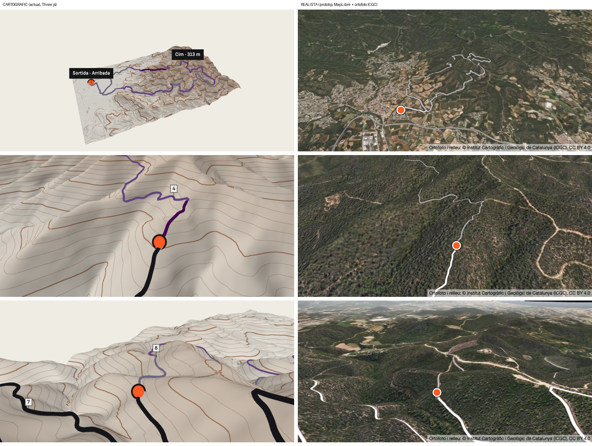

- **Motor:** MapLibre GL JS 6.17.0 (BSD-3-Clause), amb relleu 3D, cel i boira.
- **Dades, totes de l'ICGC (CC BY 4.0) i sense clau:**
  - Ortofoto: `geoserveis.icgc.cat/servei/catalunya/mapa-base/wmts/orto/MON3857NW/{z}/{x}/{y}.png`, fins al zoom 20.
  - Relleu de 5 m en terrain-RGB: `geoserveis.icgc.cat/servei/catalunya/contextmaps-terreny-5m-rgb/wmts/{z}/{x}/{y}.png`, zooms 7 a 14.
- **Resultat:** l'ortofoto sobre el relleu real es veu a totes les vistes, amb pistes i camins reconeixibles. Cap error.

**Decisió:** realista per defecte, amb un commutador per passar al cartogràfic. Integrat a M2:

| Escriptori | Mòbil |
|---|---|
| 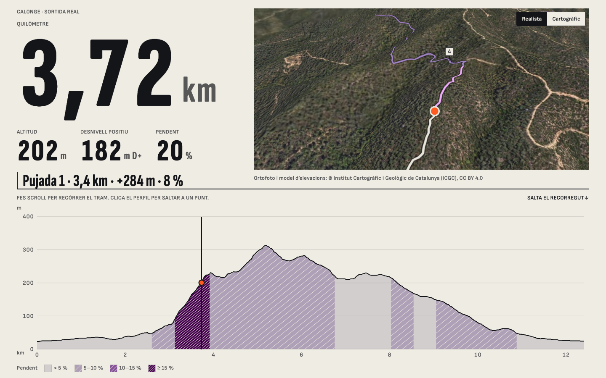 | 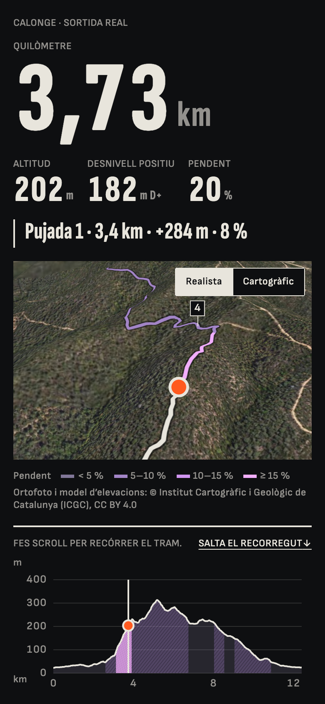 |

- **Fa el mateix que el cartogràfic:** la càmera segueix el scroll, el traçat per recórrer diu el pendent, hi ha fites, i perfil i vista assenyalen el mateix punt en tots dos sentits.
- **Colors:** sobre la fotografia el terra és fosc, i el traçat fa servir els colors de nit dels tokens en tots dos temes.
- **Commutador "Realista / Cartogràfic"** a la cantonada de la vista. Cada motor es carrega només quan es tria, el canvi conserva el punt del recorregut i la tria es recorda. Amb estalvi de dades activat, es comença pel cartogràfic.
- **El mapa no agafa gestos:** el scroll de la pàgina continua manant, també al mòbil.
- **Exageració vertical:** × 1,3 (el cartogràfic va a × 1,5).
- **Proves:** les tessel·les de l'ICGC se simulen, de manera que no depenen dels seus servidors. No comproven que l'ortofoto real carregui.

| Mesura | Realista (MapLibre) | Cartogràfic (actual) |
|---|---|---|
| Codi del motor, gzip, mesurat a la build | 452 KB (295 KB + 148 KB del *worker* + 10 KB de CSS) | 225 KB |
| Dades del terreny | Unes 14 MB per recórrer tota la ruta en un mòbil a 3× (8,4 MB d'ortofoto i 5,8 MB de relleu) | 63 KB |
| Primera vista | 3,4 MB | 63 KB |
| Servidors en ús | Els de l'ICGC, mentre es mira | Cap de tercers |
| Mode nit | L'ortofoto no en té | Sí |
| Cobertura | Catalunya | On hi hagi model d'elevacions |

El que això obre:

- **Pressupost:** el motor realista supera els 250 KB de CLAUDE.md. Excepció acceptada l'11-11-2026: es carrega en diferit i només si es tria.
- **Sense provar en un dispositiu real**, ni la fluïdesa ni el consum de dades. Dibuixat per programari és força més lent que el cartogràfic.
- **Dades:** 14 MB per ruta és molt amb dades mòbils. Es pot reduir preparant en build només el corredor de la ruta (ortofoto en WebP o AVIF i el relleu de 10 m que ja tenim) i servint-lo des de R2.
- **Fora de Catalunya:** el relleu obert existeix (Mapterhorn); la imatge de satèl·lit de qualitat acostuma a ser de pagament o amb clau.
- **"Més que Relive":** a Catalunya l'ortofoto de l'ICGC té més detall que la imatge de satèl·lit habitual. Arbres i edificis en volum demanarien malles fotogramètriques (Google Photorealistic 3D Tiles), de pagament i amb cobertura rural incerta.

## Pendent

- **Renderitzat per programari:** a Chromium sense GPU (les proves i la CI) cada fotograma triga uns 250 ms, i un scroll suau amb l'escena en marxa dura segons. Les proves ho toleren; no diu res d'un dispositiu amb GPU.
- **Fotogrames per segon reals.** Les mesures fetes només compten l'enviament d'ordres, no el dibuix: no valen. És E04, amb un iPhone de fa 3–4 anys i un Android de gamma mitjana. La prova amb el Galaxy S25 diu que funciona en un mòbil potent, no com va en un de modest.
- **Safari (iPhone inclòs) i Firefox:** no s'hi ha provat.
- **Regressió visual del 3D:** la captura de referència de M2 és el pòster, no l'escena.
- **Color per ritme** al traçat (8.1): el GPX de prova no en porta.
- **Punts d'interès amb dades pròpies** (avituallaments, controls): el GPX de prova no en porta.
- **Variant realista** amb ortofoto.
- **Mòbils baixos** (menys de 700 px d'alt): el 3D hi queda petit.
