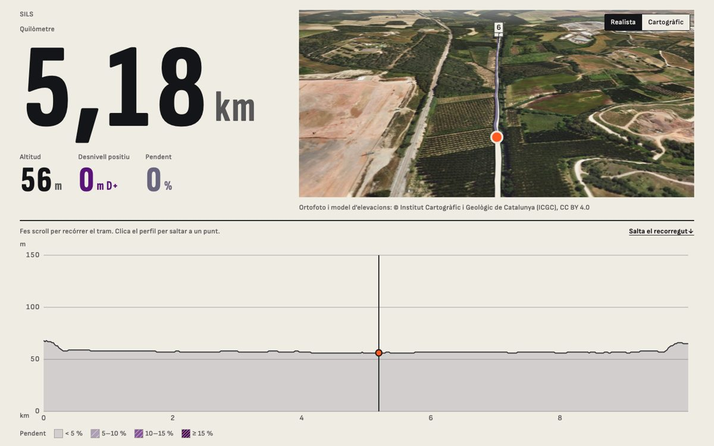
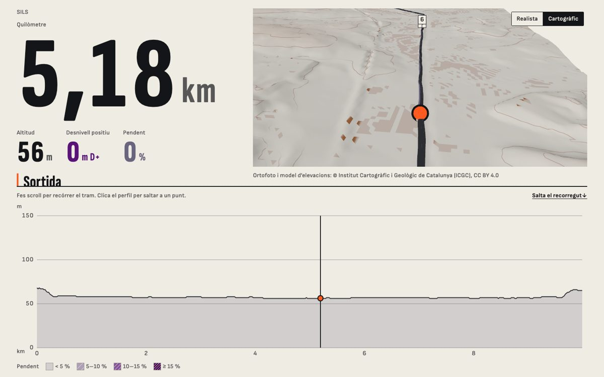
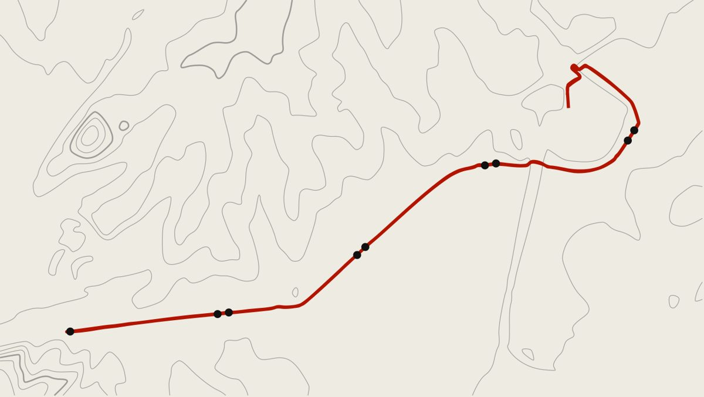
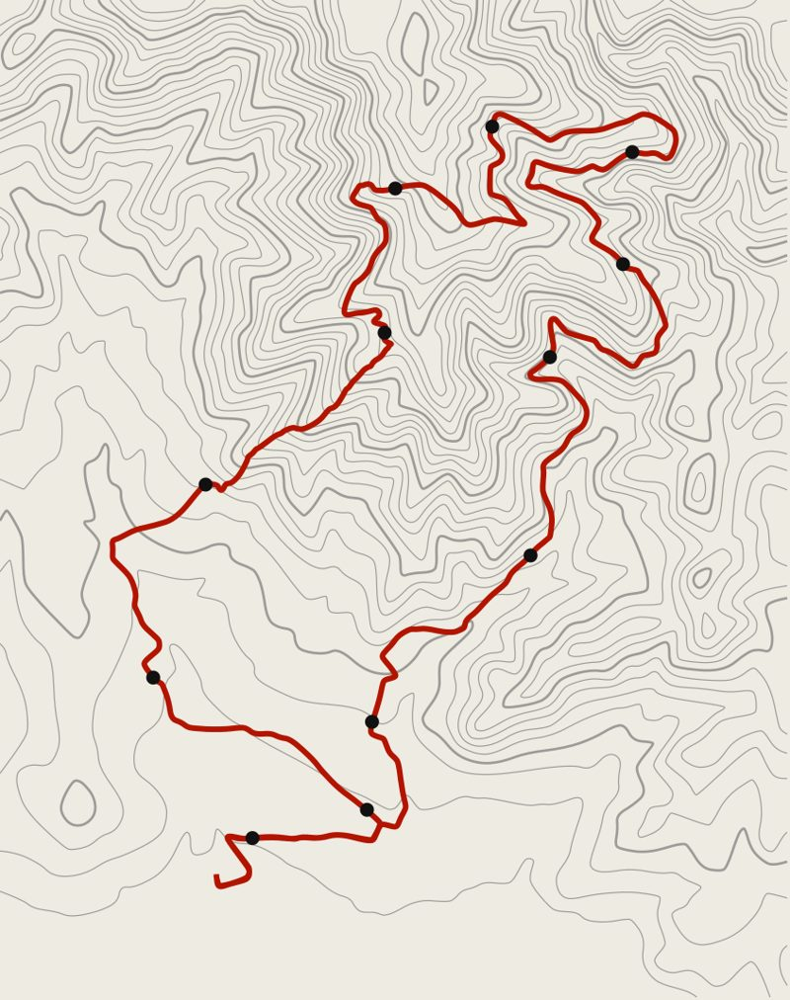
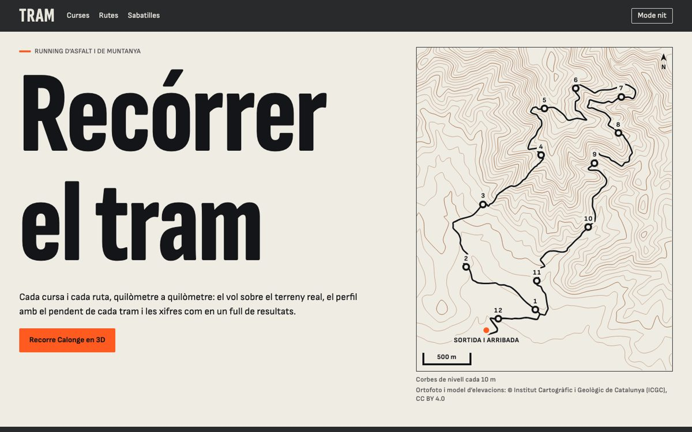

# E03 · Visor d'una ruta plana

**Estat:** decidit i integrat a les fitxes de cursa i de ruta · **Data:** 2026-11-12 · **Decisió:** ortofoto al vol, plànol en línies com a imatge de la ruta, i cap escala que faci semblar muntanya el que és pla

## Pregunta

Un terreny pla en 3D és avorrit. Com es fa atractiva una ruta d'asfalt sense falsejar-ne el desnivell?

## Punt de partida

La ruta de Sils (9,99 km, d'anada i tornada, entre 56 i 68 m d'altitud) amb el visor de M2 tal com va sortir de la Fase 0:

- **Realista** (ortofoto de l'ICGC): funciona. El que té d'interessant una ruta plana és per on passa, i la foto ho ensenya.
- **Cartogràfic**: el relleu no diu res i el model d'elevacions hi deixa taques (terrasses, edificis).
- **El pòster** del visor (la silueta de la ruta abans de carregar el 3D) s'ajustava al seu propi rang d'altituds: 12 m de desnivell omplien la caixa i **dibuixaven una serralada**. Era l'únic punt on el web deia una cosa falsa.
- **El perfil** ocupava mitja pantalla per ensenyar una línia recta.

## Opcions

| Opció | Què aporta | Per què sí o no |
|---|---|---|
| Edificis extrudits | Volum on no hi ha relleu | No: cal una font de dades nova (cadastre o OSM), un altre pes de descàrrega, i Sils és sobretot camps. Queda per a una marató urbana (M1). |
| Cinta de ritme | Converteix el traçat en dada | **No fet**: surt dels temps del GPX, que no s'han publicat mai. Necessita el vistiplau de qui ha fet la sortida. |
| Plànol en línies | La forma de la ruta és la seva identitat | **Sí**: `RoutePlate`. |
| Exagerar el relleu | Faria «bonic» el 3D | No: és exactament falsejar el desnivell. |

## Decisió

1. **La imatge d'una ruta és el seu plànol**, no la seva silueta: `RoutePlate` dibuixa el traçat des de dalt sobre les corbes de nivell, en SVG inline, sense script ni imatge. El genera `@tram/terrain-pipeline` (`plate-cli`) un cop per ruta, a partir del mateix terreny del visor: suavitzat, *marching squares*, simplificació i corbes. Sils pesa 18,5 KB i Calonge 69,8 KB (29 KB comprimit).
2. **El mateix interval de corbes per a totes les rutes** (10 m, mestres cada 50 m). El relleu es llegeix per la densitat de línies: Calonge en té 34 nivells i Sils, 6. No hi ha cap interval «adaptat» que faci semblar muntanya un pla.
3. **La silueta mai s'estira**: per sota de 100 m de desnivell, la caixa del pòster i la del perfil representen 100 m. Una ruta plana es dibuixa plana.
4. **Les llistes comparteixen escala vertical**: a `RaceRow`, la silueta de la cursa plana és una línia al costat de la de muntanya.
5. **El perfil cedeix l'alçada de la pantalla** al visor (26 % de l'alçada, no una mida fixa), i a les fitxes ja no es talla cap xifra en un portàtil.
6. **La vista realista continua sent la predeterminada**, que és la que fa interessant un recorregut pla.

## Què no s'ha verificat

- **La cinta de ritme** no s'ha construït: depèn d'un permís que no s'ha demanat encara.
- **El terra de la ruta** (asfalt, pista, corriol) no surt del GPX. La fitxa de ruta no en diu res; la cursa de mostra de Sils porta l'etiqueta «Asfalt» perquè és una cursa inventada per provar la pàgina, no perquè s'hagi comprovat.
- Els plànols no s'han provat amb una ruta urbana densa ni amb una de més de 40 km: el pes del SVG creix amb el relleu.
- Les marques de quilòmetre d'una ruta d'anada i tornada queden a parells; es llegeix, però no s'ha provat amb gent.
