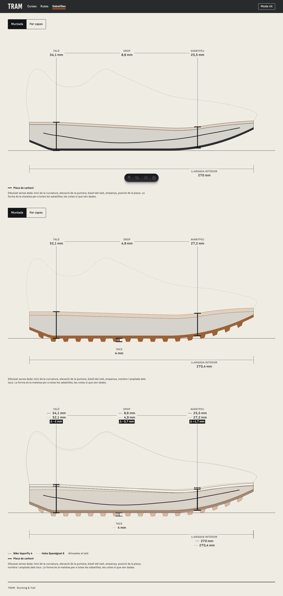
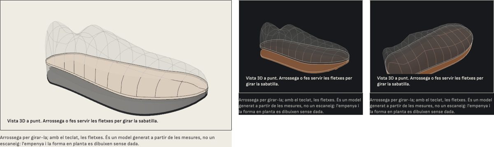

# E05 · Tècnica de la radiografia paramètrica

**Estat:** decidit i integrat a la fitxa de sabatilla i al comparador · **Data:** 2026-11-12 · **Decisió:** (a) perfil lateral 2D a partir de les dades, dibuixat en SVG com a plànol tècnic, i el mateix perfil amb amplada per a la vista 3D

## Pregunta

Com es dibuixa una sabatilla a partir de `shoe_specs`, de manera que es puguin superposar dos models i que el dibuix no digui res que les dades no diguin?

## Opcions

| Opció | Fidelitat a les dades | Plànol tècnic | Superposició | Pes |
|---|---|---|---|---|
| **(a) Perfil 2D + extrusió** | Alta: cada cota és una dada | Natural | Neta: dues línies | SVG al HTML, 0 KB de JS; el 3D afegeix 3,9 KB a l'illa de Three.js |
| (b) SDF amb *raymarching* | Mitjana: la forma surt d'una fórmula | Difícil d'acotar | Confusa: dos volums | Tot en shader, car en mòbil |
| (c) Malla plantilla deformada | Baixa: la plantilla ja és una sabatilla inventada | Poc | Dues malles opaques | Un model per carregar |

S'ha construït (a). Les altres dues no s'han prototipat: (b) i (c) dibuixen sobretot el que **no** és dada (l'empenya, les formes), que és el contrari del que es busca.

## Què s'ha fet

- **`packages/shoe-geometry`** (TS pur, 13 proves): `buildShoeProfile(specs)` torna les capes (sola, mitjasola, plantilla), els tacs, la placa, l'empenya i les cotes, en mil·límetres. `buildShoeSolid` hi afegeix l'amplada per al 3D.
- **`ShoeXray`** (SVG, sense JavaScript): una sabatilla amb cotes de taló, avantpeu, drop, tacs i llargada; el commutador «Per capes» separa les capes amb CSS. Amb dues sabatilles és **M3**: superposades, alineades al taló i a terra, la segona en línia discontínua, i cada cota amb les dues xifres i la diferència amb signe.
- **Vista 3D** (`three/shoe-viewer`, dins de `Viewer3DShell`): el mateix perfil amb l'amplada mesurada del taló i de l'avantpeu. Es gira arrossegant (amb el dit, només de costat, perquè la pàgina continuï fent scroll) o amb les fletxes. L'escuma és translúcida. Dibuixa només mentre gira.

## El mínim de dades per sabatilla

| Dada | Camp | Sense ella |
|---|---|---|
| Llargada interior | `length_mm` (nou) | **No es pot dibuixar.** Si cap laboratori la dona, la llargada nominal de la talla, dient-ho. |
| Alçada al taló i a l'avantpeu | `stack_heel_mm`, `stack_forefoot_mm` | **No es pot dibuixar.** Es prenen al 12 % i al 75 % de la llargada (norma de World Athletics). |
| Placa | `plate` | Es dibuixa sense placa. |
| Tacs | `lug_depth_mm` | Es dibuixa sense tacs. |
| Gruix de la sola i de la plantilla | `outsole_thickness_mm`, `insole_thickness_mm` (nous) | Gruix neutre, i es diu. |
| Alçada de la puntera | `toebox_height_mm` (nou) | Alçada neutra. |
| Amplada al taló i a l'avantpeu | `width_heel_mm`, `width_forefoot_mm` | No hi ha vista 3D. |
| Inici de la curvatura, elevació de la puntera, bisell del taló | `rocker_apex_pct`, `toe_spring_deg`, `heel_bevel_deg` | Forma neutra, igual per a totes, i es diu. |

Els tres camps nous són a la migració `20261112100000_shoe_profile_fields.sql`.

**El que no és dada es diu.** El perfil torna la llista del que ha hagut de suposar (`assumed`) i `ShoeXray` l'escriu sota el dibuix. Les formes neutres són les mateixes per a totes les sabatilles: dos perfils no es diferencien mai per una suposició, només per les seves xifres.

## Les dues sabatilles

Nike Vaporfly 4 (asfalt, placa de carboni) i Hoka Speedgoat 6 (muntanya, tacs). Mesures de laboratori de RunRepeat; xifres declarades de les pàgines de Nike i Hoka; puntuacions de RunRepeat, OutdoorGearLab i Running Shoes Guru, cadascuna a la seva escala. Tot consultat el 12 de novembre de 2026, amb l'enllaç a `apps/web/src/content/shoes.ts`.

## Prototip: el model amb les fotos de la marca

Demanat el mateix dia: una sabatilla que es giri i es vegi com la real, feta a partir de les fotos oficials.

- `apps/web/scripts/photo-model.py` retalla la sabatilla de la foto lateral, de la interior, de la de dalt i de la del taló, i en treu la silueta de costat i en planta.
- `three/shoe-viewer/photo.ts` dona volum a aquesta silueta (amb l'amplada mesurada de l'avantpeu) i hi posa cada foto des d'on es va fer.
- Fet per al Nike Vaporfly 4. De costat, de dalt i de darrere és fidel a les fotos; de front i per sota és aproximat, perquè cap foto hi mira de cara. No és un escaneig.
- **Les fotos són de la marca i no són al repositori.** Viuen a `apps/web/src/content/shoes-local/`, que git no segueix; sense elles el visor mostra el model de mesures. S'han desplegat només a l'entorn de proves, per decisió expressa. `CLAUDE.md` 7.6 diu que no es fan servir fotos de màrqueting de les marques: portar-ho a producció demana el permís de la marca i canviar aquesta regla.
- El Hoka Speedgoat 6 no té model amb fotos. El retall de l'ombra de sota la sola suposa una sola de color: una sola negra demana un altre criteri.

## Què no s'ha verificat, i què queda obert

- **No és un escaneig.** La vista 3D és un model generat a partir de les mesures: no té textura, ni el dibuix de la sola, ni l'empenya real. Una vista fotorealista com la d'un escàner 3D és la capa B (E06): cal tenir la sabatilla i escanejar-la. El visor ja té el lloc per a aquest model.
- **Cap de les dues sabatilles té mesurats** l'inici de la curvatura, l'elevació de la puntera ni el bisell del taló. Es dibuixen amb la forma neutra.
- **La posició de la placa** dins l'escuma no la publica ningú: es dibuixa amb una forma de cullera comuna, i es diu.
- **Les alçades declarades per Nike** (35 i 29 mm) no s'han llegit a la pàgina de Nike, sinó citades per RunRepeat; la fitxa ho indica.
- **La puntuació d'OutdoorGearLab del Vaporfly 4** és de la prova del model de dona; la fitxa ho indica.
- **Les dates de llançament** no s'han confirmat en cap font llegida i no es mostren.
- **Revisió legal pendent**: l'ús dels noms de marca i la reutilització de mesures de laboratori de tercers. Les pàgines de sabatilles porten `noindex` i no entren en una construcció de producció fins que `legalReview` sigui `cleared`.
- Les xifres de les fonts es van llegir amb una eina que resumeix la pàgina; les principals es van llegir dues vegades i coincideixen, però convé que una persona les repassi contra les pàgines enllaçades.
- La vista 3D s'ha provat amb el renderitzador per programari de les proves i al Chromium d'aquest Mac, no en un mòbil real.
- En mòbil el dibuix acotat fa uns 330 px d'ample: es llegeix, però les cotes queden justes.
