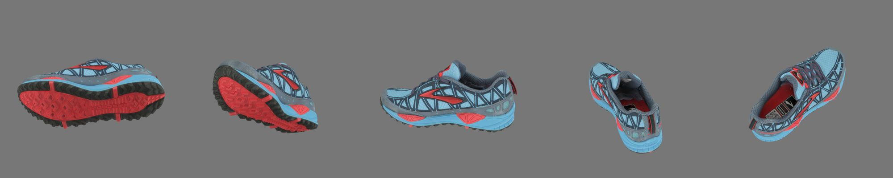
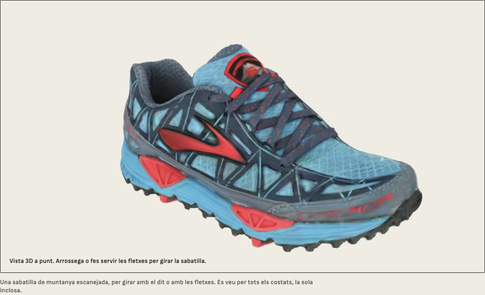

# E06 · Pipeline de splats gaussians (capa B)

**Estat:** camí provat de punta a punta amb una mostra; falta la captura d'una sabatilla de debò i la transició a la radiografia · **Data:** 2026-11-25 · **Decisió:** entrenar amb Brush, comprimir a SPZ i dibuixar amb el renderer de splats de three.js sobre el motor que ja comparteixen totes les vistes 3D. Spark, que era la hipòtesi, queda descartat pel pes.

## Pregunta

Com es passa d'una sabatilla que tenim a les mans a un model que es gira al navegador, amb eines lliures, en un Mac de 8 GB, i dins del pressupost de pes de la web?

## Què s'ha fet

Encàrrec del titular («avanti», 25 de novembre): muntar el camí amb una mostra mentre no hi ha captura pròpia. Les eines i la mostra són a `~/ProjectesClaude/TRAM/splats/`, fora d'aquest repositori (el seu `README.md` porta les ordres).

1. **Captura.** No n'hi ha cap de nostra encara. La mostra és un model de Google Scanned Objects (© Google, CC BY 4.0), una sabatilla de muntanya, «fotografiat» amb Blender des de 150 punts al voltant, sola inclosa, com si se li donés la volta amb el mòbil.
2. **On era la càmera.** COLMAP (pycolmap 4.2.1) situa 75 de 75 fotos en 34 segons, amb un error de 0,43 px, sense saber-ne res d'entrada. És el pas que una captura real necessita.
3. **Entrenament.** Brush 0.3.0, a la GPU del Mac: 7.000 passos en 8 minuts (19.863 splats) o 20.000 passos en uns 30 (32.463 splats). El segon es veu clarament més nítid.
4. **Compressió.** `splat-transform` de PlayCanvas, a SPZ: **632 KB** el de 32.463 splats (368 KB el curt). L'objectiu era menys de 8 MB.
5. **A la web.** `three/splat-viewer` dins de `Viewer3DShell`, com la resta de vistes: es gira arrossegant o amb les fletxes, i dibuixa només quan gira. Prototip a `/ds/explorations/e06-splat/`.

## Opcions de renderitzat

| Opció | Pes del codi | Motor | Resultat |
|---|---|---|---|
| **Renderer de splats de three.js** (`GaussianSplat`, r187) | El visor sencer entra al pressupost (250 KB per illa) sense excepció | El `WebGPURenderer` que ja fan servir les altres illes, amb el seu pas a WebGL 2 | **Triat.** Dibuixa bé amb WebGPU i amb WebGL 2 |
| Spark 2.4 (la hipòtesi de CLAUDE.md) | **1,0 MB comprimit**, quatre vegades el pressupost | WebGL 2, amb un renderer a part | Descartat pel pes; no s'ha arribat a dibuixar-hi res |

CLAUDE.md deia de comprovar en quina versió arribava el renderer natiu: és a la que la web ja té instal·lada.

## Què s'ha après

- **Els colors:** un splat porta els colors de les fotos, ja com els ensenya una pantalla. Si el renderer els torna a convertir surten pàl·lids; el visor li diu que no ho faci.
- **L'enquadrament:** un entrenament deixa uns quants splats lluny de l'objecte. El visor situa i mesura la sabatilla entre el centil 1 i el 99 de cada eix, no amb la caixa de tots.
- **L'eix vertical:** el fitxer de Brush diu «eix vertical: y» a la capçalera, però conserva els eixos de la captura (aquí, la Z amunt).
- **El fons:** amb fotos de fons transparent, Brush entrena només l'objecte. Una captura real portarà la taula i l'habitació: caldrà retallar-la (`splat-transform` té filtres de caixa i de trossos solts), i això no s'ha provat.

## Protocol de captura

Escrit a partir del que demana la tècnica; **no s'ha provat amb cap captura real**. És a `~/ProjectesClaude/TRAM/splats/README.md`: un vídeo d'un minut o de 60 a 100 fotos, tres voltes a alçades diferents, llum repartida, una superfície amb dibuix a sota, la sabatilla sense moure. La sola no surt si la sabatilla reposa a la taula.

## Què falta del lliurable

- **«Un model escanejat de principi a fi»:** el camí hi és, però amb un model ja escanejat per un altre. Falta fer-lo amb una sabatilla nostra: fotos de mòbil, llum real, fons real.
- **«La transició de splat a radiografia»:** no s'ha fet. Necessita una sabatilla que tingui alhora splat i les dues alçades declarades; la de la mostra no és al catàleg.
- **Nivells de detall:** no han calgut amb 632 KB. Amb una captura real, que donarà més splats, es tornarà a mirar.

## Què no s'ha comprovat

- **Cap mòbil de debò.** Sense WebGPU (la majoria de telèfons) el camí de WebGL 2 dibuixa bé en un Chromium de proves, a mida de mòbil i d'escriptori. Amb WebGPU s'ha vist bé en un navegador d'escriptori de debò; en un Chromium sense finestra dona errors de validació i surt en blanc, cosa que semblen ser del mode sense finestra i no del visor, però **en un telèfon amb WebGPU no s'ha vist**.
- **Safari i Firefox.**
- **El rendiment:** fotogrames per segon i memòria amb 32.000 splats en un telèfon.
- **La mostra porta el nom d'una marca** a les dades d'origen. Només és al catàleg `/ds/`, que no entra a producció.
