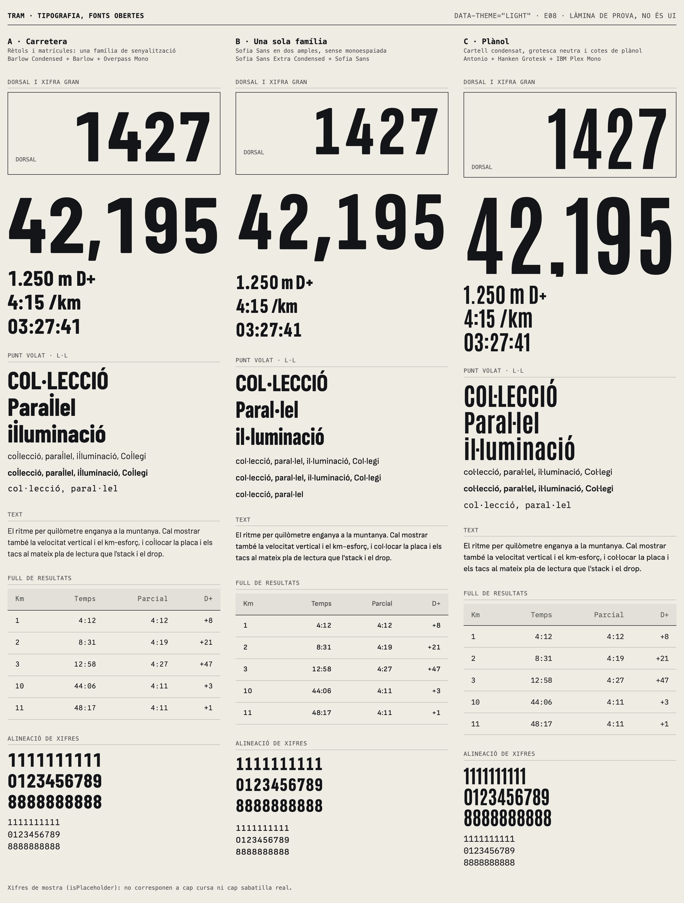
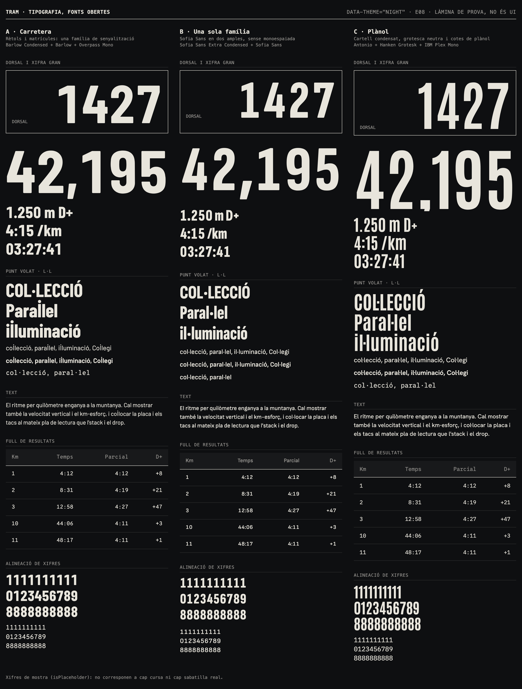
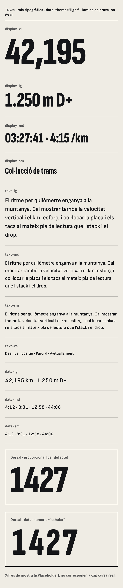
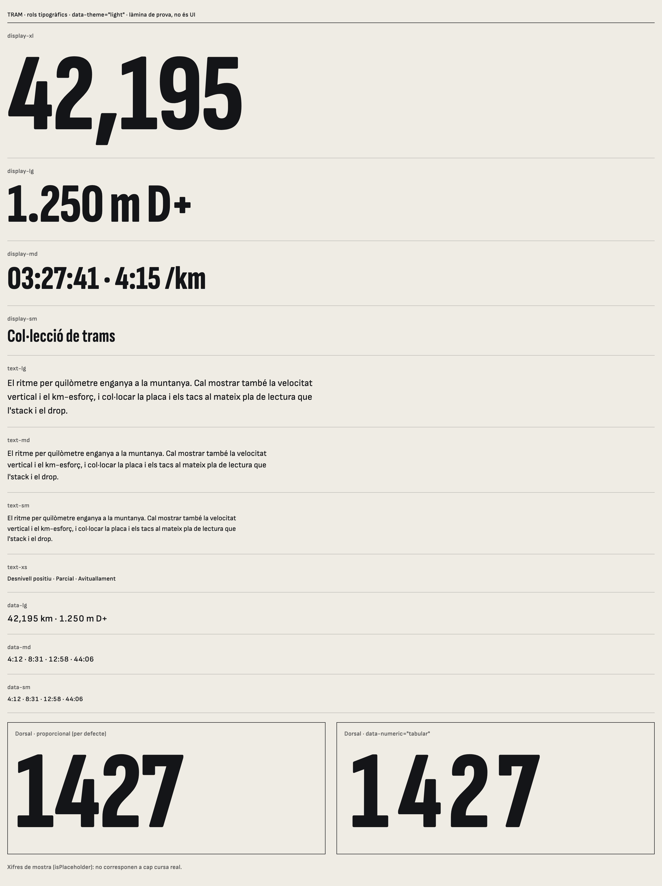
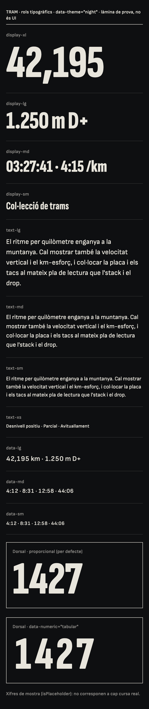
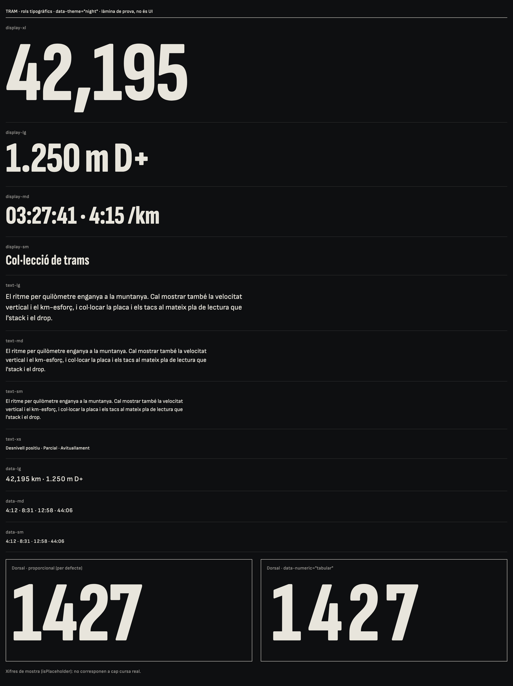

# E08 · Tipografia

**Estat:** decidida, pendent de la prova amb dades reals · **Data:** 2026-11-09 · **Decisió:** parella B, Sofia Sans Extra Condensed + Sofia Sans

## Pregunta

Quina parella de tipografies (display condensada + text + dades) dona a TRAM el caràcter del dorsal i del full de resultats, i compleix els requisits de 7.2?

## Context

- **Abast decidit:** només fonts obertes. Cost de llicència: 0. Totes les candidates són SIL OFL 1.1, segons el camp `license` de cada paquet.
- **Requisits de 7.2:** figures tabulars i *lining*, punt volat correcte (`l·l`), font variable o tres pesos com a màxim per família, subconjunt i autoallotjament.
- **Prohibides:** Inter, Roboto, Poppins, Montserrat, Open Sans, Space Grotesk, Geist i `system-ui`. No s'han avaluat.
- **Fitxers provats:** subconjunt `latin` en WOFF2 de Fontsource 5.x, el que s'autoallotjaria.

## Filtre automàtic

S'han analitzat 43 paquets amb fontTools: xifres tabulars (per defecte o amb `tnum`), *lining*, cobertura de les lletres catalanes i eixos.

Totes tenen els caràcters catalans i figures *lining*. Queden eliminades per no tenir xifres tabulars: Big Shoulders, League Gothic, Oswald, Saira Extra Condensed, DM Sans i Libre Franklin.

## Opcions provades

| | Display | Text | Dades | Idea |
|---|---|---|---|---|
| **A · Carretera** | Barlow Condensed 700 | Barlow 400 i 600 | Overpass Mono 400 | Rètols i matrícules |
| **B · Una sola família** | Sofia Sans Extra Condensed 800 | Sofia Sans 400 i 600 | Sofia Sans 500 tabular | Un sol sistema en dos amples |
| **C · Plànol** | Antonio 700 | Hanken Grotesk 400 i 600 | IBM Plex Mono 400 | Cartell i cotes de plànol |

## Mesures

Chromium 153 a macOS, amb les fonts carregades. El `l·l` es mesura sobre els píxels renderitzats a 200 px i amb `lang="ca"`. Dades completes a [`E08/measures.json`](E08/measures.json).

| Criteri | A · Carretera | B · Una sola família | C · Plànol |
|---|---|---|---|
| **`l·l` amb `lang="ca"`** | **Trencat: el punt va a sobre de la `l`** | Correcte a tots els pesos | Hanken: punt enganxat a la primera `l` |
| Marge esquerre / dret del punt (text 400, em) | no mesurable | 0,140 / 0,145 | **0,005 / 0,150** |
| Marge esquerre / dret del punt (display, em) | no mesurable | 0,070 / 0,065 | 0,055 / 0,055 |
| Variació d'amplada de les xifres, display (px sobre 100) | 0 | 0 | **16,3 (Antonio no és tabular a 700)** |
| Variació d'amplada de les xifres, text i dades | 0 | 0 | 0 |
| Pes total (`latin`, WOFF2) | 87,3 KB | 79,0 KB | 74,2 KB |
| Fitxers | 4 | 2 | 3 |
| Pes de la display, candidata a *preload* | 21,9 KB | 39,6 KB | 26,0 KB |
| Mida màxima de "42,195" en 358 px d'amplada | 132,5 px | 141,0 px | 149,1 px |
| Caràcters per línia a 16 px en 358 px | 53,7 | 53,7 | 51,0 |

**Reducció de l'eix de pes a la parella B** (fontTools `instancer`, display 700–900 i text 400–700): de 79,0 KB a **51,6 KB** (26,2 + 25,4). `test/type.browser.test.ts` comprova amb aquests fitxers que els pesos funcionen, les xifres tabulars i el `l·l`.

### Troballes clau

1. **Barlow trenca el català.** Amb `lang="ca"`, la regla `locl` de Barlow i Barlow Condensed col·loca el punt sobre la `l` i la paraula es llegeix malament ("paraİlel"). Sense `lang` el resultat és correcte i simètric, de manera que la causa és aquesta regla. TRAM serveix en català per defecte, així que queda descartada. Només s'ha provat el subconjunt de Fontsource, no el TTF original.
2. **Antonio perd les xifres tabulars en negreta.** El filtre la donava per bona perquè llegeix el mestre per defecte de la font variable. A 700, que és el pes que es faria servir, les xifres varien 16,3 px sobre 100 i no té `tnum`.
3. **Hanken Grotesk enganxa el punt a la primera `l`** quan hi ha `lang="ca"` (0,005 em a l'esquerra i 0,150 a la dreta).
4. **Sofia Sans no té regla `locl` catalana, i no li cal:** el punt queda centrat amb l'espaiat per defecte.

## Captures

Làmina de prova (no és UI de producte), amb els tokens reals de color i espai:

| | 390 px | 1440 px |
|---|---|---|
| Clar |  |  |
| Nit |  |  |

Observacions de les captures:
- A la parella B, les xifres tabulars deixen aire al voltant de l'`1` en mides grans ("1427"). És correcte en columnes, però no a la xifra gran d'un dorsal: per això els rols `display-*` són proporcionals per defecte (vegeu la làmina de rols).
- Sense monoespaiada, la taula de B perd una mica de to de "cota tècnica", però continua alineada i ben llegible.

## Recomanació

**Parella B: Sofia Sans Extra Condensed (display) + Sofia Sans (text i dades).**

1. **És l'única que supera tots els requisits al navegador.** A falla en el `l·l`. C falla en les xifres tabulars i en el `l·l` del text.
2. **Dos fitxers variables per a tots els rols.** Són 79,0 KB tal com es distribueixen i uns 51,6 KB amb l'eix reduït.
3. **Coherència:** dos amples d'una mateixa família, de manera que les xifres de dorsal i les del full de resultats comparteixen dibuix.

**Riscos i com mitigar-los:**
- *Caràcter:* és la menys singular de les tres com a text. El caràcter l'ha d'aportar la display a mida gran i la composició (7.4), i s'ha de revisar contra 7.8 al catàleg.

## Implementació

- **Rols:** `[data-type="<rol>"]` aplica família, mida, pes, interlineat i tracking. Mides fluides entre 390 i 1440 px, amb `clamp()` en `rem`.
- **Xifres:** `data-*` tabulars, `display-*` proporcionals. `data-numeric="tabular"` força les tabulars, per exemple en una columna de xifres grans.
- **Fonts:** `packages/design-system/fonts/`, carregades amb l'API de fonts d'Astro (`apps/web/astro.config.mjs`). Astro declara les mateixes variables `--tram-ref-font-*`, sense capa, i així substitueix el valor dels tokens i hi afegeix el fallback ajustat. S'ha comprovat amb una build temporal: `@font-face`, *preload* del fitxer i fallback amb mètriques.

| | 390 px | 1440 px |
|---|---|---|
| Clar |  |  |
| Nit |  |  |

`pnpm --filter @tram/design-system exec node scripts/type-proof.cjs` regenera aquesta làmina.

## Pendent

- **Prova amb dades reals.** El repositori encara no en té, i les xifres de les làmines són de mostra (`isPlaceholder`), per no inventar dades de curses.
- Verificació a Safari i Firefox reals, amb la matriu d'E04.
- Revisió de l'escala i del tracking al catàleg, amb components reals (E17).

## Com es reprodueix

Baixeu amb `npm pack` els paquets `@fontsource/barlow-condensed`, `@fontsource/barlow`, `@fontsource/ibm-plex-mono` i `@fontsource-variable/` de `overpass-mono`, `sofia-sans`, `sofia-sans-extra-condensed`, `antonio` i `hanken-grotesk`. Copieu els `.woff2` que indica l'script en una carpeta plana i executeu:

```sh
pnpm --filter @tram/design-system exec node scripts/type-specimen.cjs <carpeta-de-fonts>
```
