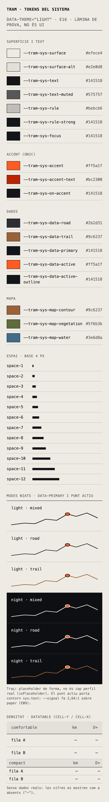
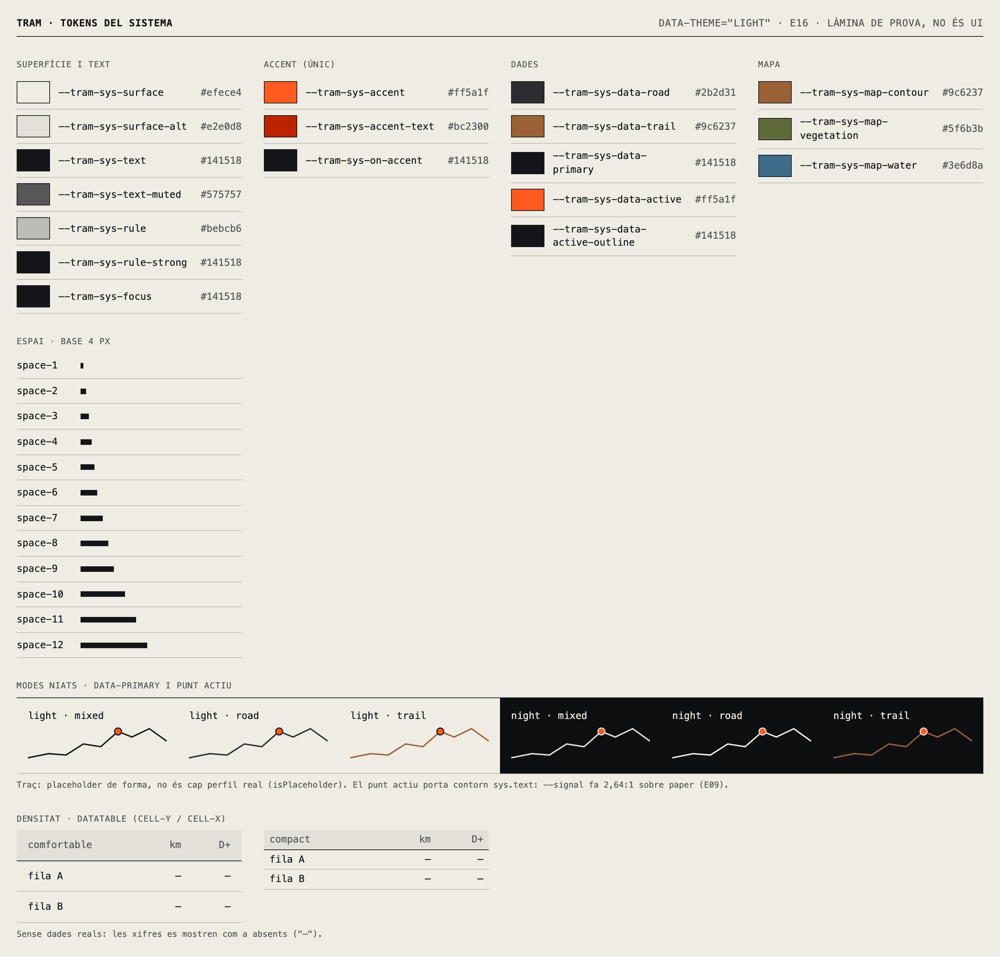
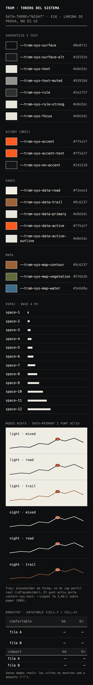
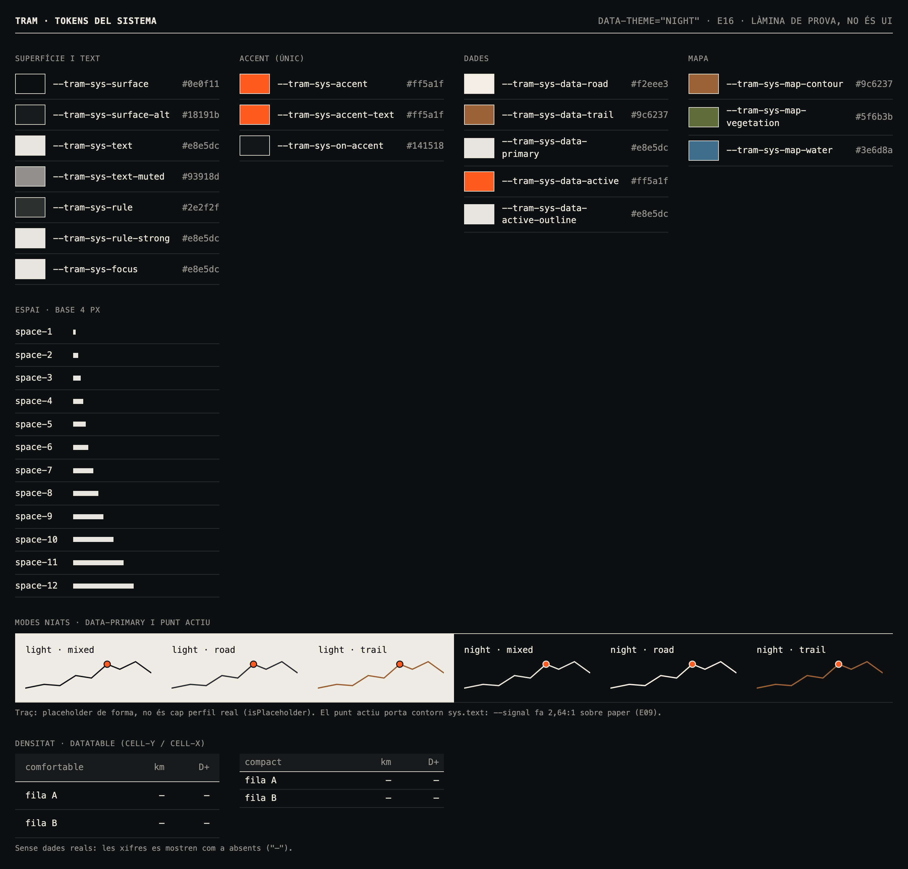

# E09 · Color i mode nit

**Estat:** paleta validada i dos problemes de contrast corregits; falten la prova a l'exterior i la prova amb fotografia real · **Data:** 2026-11-10

## Pregunta

La paleta de 7.3 funciona en mapes, gràfics i fotografia? El `--signal` es llegeix bé, també al sol? El mode nit és neutre?

## Mètode

[`scripts/color-audit.ts`](../../packages/design-system/scripts/color-audit.ts) resol els tokens amb el mateix codi que la build, i el resultat complet és a [`E09/audit.md`](E09/audit.md). Calcula:

- **Contrast WCAG** de cada rol sobre `surface` i `surface.alt`, en clar i en nit. El mínim és 4,5:1 per al text i 3:1 per als elements gràfics.
- **Llum ambiental (model):** el reflex de la pantalla suma la mateixa lluminància als dos colors. Suposa pantalla de 1.000 cd/m², reflectància del 4,5 % i 500, 10.000 i 100.000 lux.
- **Daltonisme:** simulació de Machado, Oliveira i Fernandes (2009) amb severitat completa, i distància ΔE en OKLab.
- **Neutralitat del mode nit:** croma i to OKLCH, comparats amb el blau pissarra prohibit.

## Resultats

### Contrast

Tots els rols compleixen el mínim, menys dos:

| Problema | Abans | Després |
|---|---|---|
| `sys.accent.text` sobre `surface.alt` (clar): la build no ho comprovava | 4,22:1 | **4,70:1** |
| `sys.data.active` sobre paper: obert des d'E16 | 2,64:1, amb avís | Contorn obligatori `sys.data.active.outline`: **15,47:1** |

### Llum ambiental

| Parella, tema clar | Interior | Ombra | Sol directe |
|---|---|---|---|
| Text | 13,86 | 5,14 | 1,56 |
| Text secundari | 5,88 | 3,58 | 1,47 |
| Traç de trail | 4,11 | 2,92 | 1,41 |
| Punt actiu | 2,61 | 2,15 | 1,31 |

- **Al sol directe, cap color passa de 2:1.** En aquestes condicions ho decideixen la mida, el gruix i la forma, no el color.
- **A l'ombra, el tema clar resisteix millor que el de nit:** el text secundari fa 3,58 en clar i 2,41 de nit, i el traç de trail, 2,92 i 1,79.

### Daltonisme

| Parella | Normal | Protanopia | Deuteranopia | Tritanopia |
|---|---|---|---|---|
| Corbes de nivell / vegetació | 10,2 | **0,9** | **5,6** | 12,4 |
| Punt actiu / trail | 18,1 | **7,6** | 15,3 | 16,0 |
| Punt actiu / vegetació | 27,8 | **8,5** | 20,9 | 28,3 |
| Vegetació / aigua | 12,0 | 12,1 | 12,1 | **8,1** |
| Asfalt / trail | 27,4 | 23,2 | 27,8 | 28,3 |

Per sota de 10 és fàcil confondre's, i per sota de 5 gairebé no es distingeix. **Amb protanopia, les corbes de nivell i la vegetació es confonen del tot.**

### Mode nit

El fons nit `#0e0f11` té una croma OKLCH de 0,004, davant del 0,040 del blau pissarra prohibit `#0f172a`: és gris carbó neutre, com demana 7.3.

## Canvis aplicats

1. **`ref.signal-ink`: de `#c52e00` a `#bc2300`.** S'enfosqueix en OKLab mantenint to i croma: 5,26:1 sobre paper i 4,70:1 sobre `paper-shade`. La build té una regla nova per a `accent.text` sobre `surface.alt`.
2. **`sys.data.active.outline`**, que equival a `sys.text`: el punt actiu sempre porta aquest contorn, i la build exigeix 3:1 en tots dos temes. L'avís obert des d'E16 desapareix. El cursor d'ECharts, que és una línia fina, fa servir aquest color, perquè el taronja sol no arriba a 3:1 sobre paper.
3. **Els 6 colors derivats d'E16** passen de `hypothesis` a `validated`.

## Recomanacions pendents de decisió

Aquestes recomanacions no s'han aplicat perquè afecten la identitat o components que encara no existeixen:

- **Mapes:** la vegetació ha de ser una àrea amb trama i les corbes de nivell, línies. No s'han de distingir mai dues capes només pel color, perquè amb protanopia són idèntiques. És el principi de 7.3 aplicat als mapes. Si es vol també més separació de color, caldria aclarir `--moss`, que és una decisió de marca.
- **Punt actiu:** a més del contorn, ha de tenir una forma o mida pròpia, perquè amb protanopia el taronja s'acosta al marró del trail.
- **A l'exterior:** les línies de recorregut i de perfil han d'anar amb `line-strong`, i el tema no ha de passar a nit automàticament de dia. Ara segueix el sistema operatiu, i és correcte.

## Captures

| | 390 px | 1440 px |
|---|---|---|
| Clar |  |  |
| Nit |  |  |

## Pendent

- **Prova a l'exterior** amb els dispositius de referència (E04), amb la pantalla al màxim i al sol. El model de llum ambiental n'és una aproximació, no la substitueix.
- **Fotografia real:** el repositori encara no en té.
- Revisar la simulació de daltonisme sobre els components amb patrons (bandes, terreny), no només sobre parelles de color.
