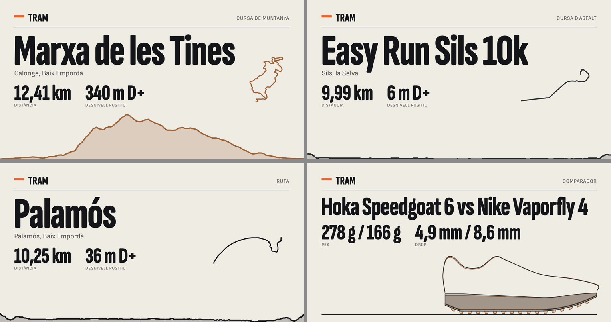

# E14 · Imatges per compartir

**Estat:** decidida i en ús per a curses, rutes i comparacions · **Data:** 2026-11-15 · **Decisió:** un SVG escrit a mà amb el text convertit a traços, passat a PNG amb `sharp`; Satori, no

## Pregunta

Com es genera en build una imatge per compartir (M5) amb el perfil real i tipografia de dorsal?

## Opcions

| | SVG propi → PNG (`fontkit` + `sharp`) | Satori + resvg |
|---|---|---|
| Què es dibuixa | Qualsevol SVG: els mateixos camins que el perfil i la radiografia de la pàgina | HTML amb flexbox; un perfil s'hi ha d'incrustar igualment com a SVG |
| Tipografia | El text es converteix a traços amb els fitxers `woff2` del sistema de disseny | No llegeix `woff2`: caldria afegir les fonts en un altre format |
| Dependències noves | `fontkit` i `sharp`, només en build | `satori`, `@resvg/resvg-js` i les fonts duplicades |

## Decisió

L'SVG propi. La imatge és gairebé tota dibuix (perfil, traçat, siluetes), que ja es genera com a camins per a la pàgina, i el text són tres línies.

## Com està fet

- `apps/web/src/og/render.ts` compon la imatge de 1200 × 630: «TRAM» i la barra d'accent a dalt, el nom a mida de dorsal (s'encongeix fins que hi cap), el lloc, dues xifres com en un full de resultats i, a baix, el perfil real de banda a banda. A la dreta, el traçat vist des de dalt.
- `apps/web/src/og/cards.ts` treu el nom i les xifres del mateix contingut que la pàgina, amb els mateixos formats.
- `apps/web/src/pages/og/[...path].png.ts` en fa un fitxer per pàgina en la build: `/og/curses/<slug>.png`, `/og/rutes/<slug>.png` i `/og/comparar/<parella>.png`. Pesen entre 8 i 23 KB.
- `Site.astro` hi afegeix `og:image` (amb mides i text alternatiu), `og:title`, `og:description`, `og:url` i `twitter:card`.
- **Colors** dels tokens (`@tram/design-system/og`): el perfil d'una cursa de muntanya en el color de trail, el d'asfalt en el d'asfalt. Una ruta no diu res del terra i va en el color neutre.
- **Una ruta plana es dibuixa plana**: la caixa del perfil val 100 m com a mínim, igual que a la pàgina.
- **La comparació** porta les dues sabatilles de perfil, una sobre l'altra i taló amb taló, com la radiografia, i pes i drop de totes dues.

## La ruta com a story (19-11-2026)

Un segon format, vertical, per a les stories d'Instagram i els estats de WhatsApp. No és la imatge d'un enllaç: és una imatge que la persona desa o comparteix ella mateixa.

- **1080 × 1920**, en dues versions: clara i fosca (`-nit`). A `/stories/rutes/<slug>.png` i `/stories/curses/<slug>.png`, només per a pàgines amb track. Pesen entre 30 i 105 KB.
- **Què hi ha:** «TRAM» i què és la pàgina, el nom a mida de dorsal, el lloc, el recorregut sobre les corbes de nivell amb la sortida, l'arribada i els quilòmetres, les xifres i el perfil de banda a banda. Una ruta que diu el seu temps porta quatre xifres: distància, temps, ritme mitjà i desnivell positiu. La resta, tres: distància, desnivell positiu i punt més alt. Un plànol més alt que ample deixa les xifres en columna al costat; un d'ample, a sota, en fila o en dues files de dues.
- **Franges lliures:** els 250 px de dalt i els 250 de baix no porten res més que el fons. És on Instagram posa el nom del compte i la barra de resposta. Una prova ho comprova píxel a píxel.
- **Crèdit a la imatge mateixa:** «Relleu: ICGC, CC BY 4.0». Les corbes surten del model d'elevacions de l'ICGC, i la llicència demana citar-lo allà on es mostra l'obra; una imatge que circula sola no porta el peu de la pàgina.
- **Cap adreça web:** el domini encara no està comprat. Quan n'hi hagi, hi ha lloc a la capçalera.
- **Temps i ritme, amb permís (19-11-2026):** el titular dels quatre tracks va demanar que hi sortissin. Es publica el temps total amb el rellotge en marxa (`scripts/gpx-time.mjs`: la suma dels passos entre punts, sense els de més de deu segons, que són pauses) i el ritme mitjà que en surt. Res més de les hores: ni el dia, ni l'hora, ni el temps de cap punt, ni ritmes per quilòmetre. Les pulsacions i la cadència, mai. La story d'una cursa no porta temps: el track és el seu recorregut, no la sortida de ningú.
- **A la pàgina** (`sections/RouteShare.astro`): les dues versions en petit, cadascuna amb «Baixa-la», que és un enllaç amb `download` i no necessita JavaScript. On el navegador pot passar un fitxer a una altra aplicació (`navigator.canShare` amb fitxers; al mòbil, gairebé sempre), una illa hi afegeix «Comparteix», que obre el menú de compartir del sistema amb la imatge.
- `apps/web/src/og/story.ts` la dibuixa, amb les mateixes funcions de text i els mateixos tokens que la imatge d'enllaç; `og/stories.ts` en treu les dades del mateix contingut que la pàgina.

**No verificat:** no s'ha compartit cap imatge des d'un telèfon real. Que el menú del sistema ofereixi «Stories» d'Instagram depèn de l'aplicació i del sistema; el que la prova comprova és que el navegador rep el fitxer correcte. Les mides de les franges lliures són les que es recomanen habitualment per a stories, no una xifra oficial que hàgim mesurat.

## Què no s'ha verificat, i límits

- **No s'han provat a cap xarxa**: no s'ha enganxat cap enllaç a WhatsApp, X ni Instagram per veure com la mostren. Les adreces de les imatges apunten a `tramrun.com`, que encara no existeix: a staging la imatge es genera, però l'enllaç compartit no l'ensenyarà.
- **El pes de la lletra no és el de la pàgina.** Els fitxers de font són variables, i la llibreria només en sap dibuixar el pes per defecte: 700 per a la lletra de dorsal (la pàgina fa servir 800) i 400 per al text. La de dorsal s'engruixeix amb un traç del mateix color perquè s'hi acosti. Per tenir el pes exacte caldria afegir una font estàtica.
- **Només mode clar.** No hi ha versió de nit.
- **La portada, les llistes i les fitxes de sabatilla no tenen imatge pròpia.**
- **La cursa de mostra també en té**, amb el seu nom. No entra a producció.

## La story d'una sortida pròpia (24 de novembre de 2026)

Encàrrec del titular: «un apartat específic a la web on pujant un arxiu .gpx se't generen les imatges per stories, les versions actuals però adaptades al GPX que l'usuari pugi». És a `/ca/stories/` («Stories» al menú), només a l'entorn de proves fins que es decideixi que va a producció (`STORY_MAKER_SHOWN`).

- **El fitxer no surt del navegador.** Es llegeix allà mateix (`story-maker/track.ts`): les posicions, l'alçada i, del temps, només quant va estar gravant el rellotge, amb la mateixa regla de les pauses que `scripts/gpx-time.mjs`. El ritme cardíac i la cadència no es llegeixen. Qui el puja pot treure el temps i el ritme de la imatge.
- **El mateix dibuix.** `og/story.ts` ja no sap com s'escriu el text: rep una ploma (`Pen`). En compilar, la ploma treu els contorns de les lletres dels fitxers de font (`render.ts`); al navegador, mesura amb les fonts de la pàgina i escriu sobre un llenç (`islands/story-maker/make.ts`), al mateix pes i amb el mateix gruix afegit. Les formes es pinten com a SVG i el text a sobre. Comparada amb la story feta en compilar per a la mateixa ruta, només canvien les corbes.
- **El relleu es demana a l'ICGC des del navegador** (el seu WCS respon amb `Access-Control-Allow-Origin: *`): el rectangle de la ruta amb 400 m de marge, en cel·les prou grosses perquè el costat llarg no passi de 200 (30 m per a una sortida d'11 km; les rutes de la web es fan a 10 m). Una o dues peticions, uns 350 KB. El servidor rep el rectangle, no el traç, i la pàgina ho diu.
- **Fora de Catalunya** no hi ha relleu: surt el traç, les xifres i el perfil, sense corbes ni crèdit de l'ICGC, i la pàgina ho diu. El traç es posa en els metres del seu propi fus UTM.
- **Un GPX sense alçades** (una ruta planificada) pren les del relleu, si n'hi ha; si no, no es pot fer el perfil i es diu. **Sense temps**, no s'ofereix temps ni ritme.
- **Pes:** la pàgina carrega 2,3 KB de JavaScript; la part que llegeix i dibuixa es demana quan es tria un fitxer.
- **Peces noves al sistema de disseny:** `TextField` i `FileField`.

Comprovat: proves unitàries de la lectura i del marc (`scripts/story-maker.test.mjs`), proves de navegador amb un GPX inventat i el servei de l'ICGC substituït (dins i fora de Catalunya, sense temps, un fitxer que no és GPX), i a mà amb un GPX real de Sils a Chromium, d'escriptori i en mida de mòbil. **No comprovat:** Safari ni Firefox (el text es posa lletra a lletra on el llenç no sap espaiar-les), cap mòbil de debò, «Comparteix» (només surt on el navegador pot passar un fitxer a una altra aplicació), ni un GPX molt llarg o de la costa.

## Cinc dissenys (24 de novembre de 2026)

Encàrrec del titular, un cop el generador va funcionar al seu mòbil: «pots imaginar més dissenys seguint la mateixa imatge corporativa? […] en vull 4 més, en blanc i en mode nit». Ara una story es pot dibuixar de cinc maneres (`STORY_DESIGNS` a `og/story.ts`), totes amb el mateix cap (la marca com en un dorsal), la mateixa lletra, el paper i la tinta dels dos temes i els mateixos dibuixos:

| Disseny | Què hi mana |
|---|---|
| **Fitxa** | El d'abans: plànol, xifres i perfil al peu. És el que tenen les rutes de la web |
| **Plànol** | El mapa de banda a banda de la imatge; el nom i les xifres, sobre una franja impresa a l'inrevés (tinta en clar, paper en nit) |
| **Dorsal** | La distància, tan gran com la imatge és ampla, amb la unitat en el color d'accent; la resta, com les línies d'un full de resultats |
| **Perfil** | El perfil gran, sobre els seus nivells d'alçada i amb el punt més alt marcat; sense mapa |
| **Traç** | Només la línia de la ruta, amb els quilòmetres numerats; les xifres, en una sola línia |

- El generador els dibuixa tots cinc amb la sortida de qui hi puja el GPX, en el tema triat («Clara» o «Fosca»), i cada un apareix quan està fet. El nom del fitxer porta el disseny i el tema (`tram-story-<nom>-planol-nit.png`).
- «Plànol» ensenya el terreny per una finestra de la seva forma: es demana a l'ICGC un segon rectangle, més ample, en cel·les més grosses. Són dues peticions més, com a molt.
- Les rutes de la web segueixen oferint només «Fitxa». Fer-ne els cinc en compilar serien deu imatges per ruta; no s'ha fet.
- **Decisions meves:** «Perfil» no porta mapa (amb un plànol petit a sota quedava descompensat); «Traç» no numera un quilòmetre que cau a sobre d'un altre (anada i tornada); una ruta plana es dibuixa plana també a «Perfil», amb la línia dels 100 m que ho fa llegir.
- Comprovat: els deu resultats mirats un per un amb una ruta plana i una de muntanya, i les proves de navegador. Cinc imatges triguen 1,5 s en un Mac; en un mòbil, més, i no s'ha mesurat.

