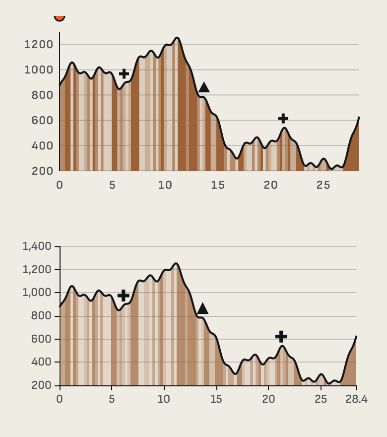
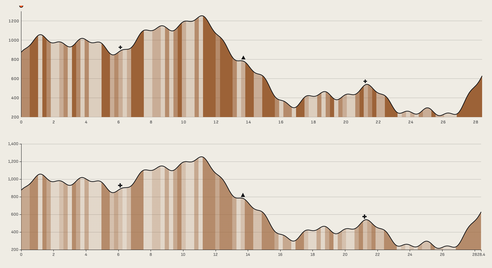
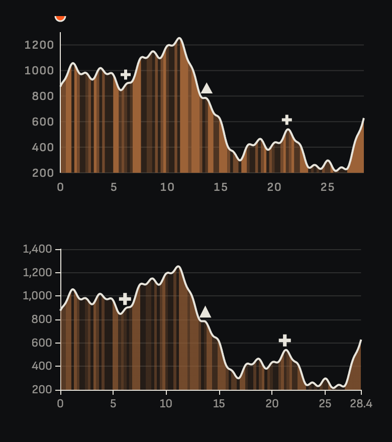
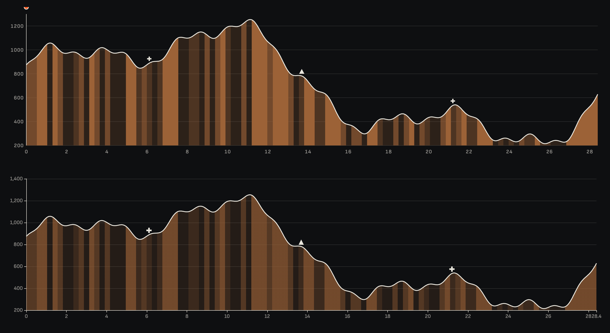

# E15 · El perfil altimètric firma: ECharts o SVG artesanal

**Estat:** decidida i provada amb dos GPX reals · **Data:** 2026-11-09 · **Decisió:** SVG artesanal per a `ElevationProfile`; ECharts per a la resta de gràfics

## Pregunta

El perfil sincronitzat amb el 3D (M2) és la peça més vista de la web. ECharts amb tema propi hi arriba, o cal un SVG artesanal amb `d3-shape` i `d3-scale`?

## Context

- **Criteris:** acabat visual, pes, sincronia amb el 3D a 60 fps, SSR i manteniment.
- **Dades:** el mateix perfil sintètic per a totes dues opcions (`isPlaceholder`), de 28,4 km i 1.200 punts, amb 74 bandes de pendent. El repositori encara no té cap GPX real.
- **Prototips:** [`E15/prototype/`](E15/prototype/). ECharts 6.1.0 amb importació modular; `d3-shape` 3.2.1 i `d3-scale` 4.0.3 només en build.

## Mesures

Chromium a macOS amb la CPU alentida 4 vegades. Mediana de 3 execucions, amb 300 fotogrames cadascuna. Dades completes a [`E15/measures.json`](E15/measures.json).

| Criteri | SVG artesanal | ECharts |
|---|---|---|
| **JS al client per a la interacció (gzip)** | **0,4 KB** | **191 KB** |
| SVG generat, mòbil (gzip) | 9,4 KB | 5,5 KB per tema |
| SVG necessaris per a clar i nit | 1 (variables CSS) | 2 (ECharts necessita colors literals) |
| Temps de generació en build | 3,6 ms | 18,4 ms |
| Muntatge al client (mòbil) | 52 ms | 254 ms |
| Actualització del cursor, mediana / p95 | 0,1 / 0,8 ms | 2,4 / 3,7 ms |
| Fotogrames perduts de 300 | 0 | 1 |

Totes dues opcions cabrien dins d'un fotograma de 16,7 ms. La diferència que pesa és la càrrega: 191 KB supera amb escreix els 30 KB de JS inicial i només seria acceptable carregada en diferit.

## Captures

A cada imatge, a dalt l'SVG artesanal i a baix ECharts.

| | Mòbil | Escriptori |
|---|---|---|
| Clar |  |  |
| Nit |  |  |

Observacions:
- **L'acabat és molt semblant,** però ECharts surt amb defectes que cal corregir un per un: milers en format anglès ("1,400") i l'etiqueta final encavalcada ("2828.4").
- **74 bandes és massa:** tant en mòbil com en escriptori semblen un codi de barres. Cal una longitud mínima de banda, independentment de l'eina. És un defecte del prototip i de les dades sintètiques, no d'una opció.
- El cursor de l'SVG apareix a la cantonada abans d'interactuar. S'ha d'amagar en el component final.

## Recomanació

**`ElevationProfile` amb SVG artesanal, generat en build. ECharts per als altres gràfics de 9.3.**

1. **Pes:** 0,4 KB davant de 191 KB, en la peça més vista.
2. **Tokens directes:** un sol SVG amb variables CSS serveix per a clar, nit i qualsevol mode niat.
3. **Sincronia:** moure el cursor és canviar dos atributs, sense passar per cap llibreria.

**Implementació:** `packages/design-system/patterns/ElevationProfile.astro`. Finalment no ha calgut d3: la geometria són unes 100 línies pròpies amb tests, i les bandes curtes s'absorbeixen per evitar l'efecte de codi de barres.

**Riscos i com mitigar-los:**
- *El codi és nostre:* eixos, marques i POIs s'han de mantenir. El prototip té unes 45 línies de dibuix.
- *Comparació parcial:* el prototip SVG només té cursor i etiqueta, mentre que ECharts porta el seu tooltip complet. Un tooltip amb format de full de resultats afegirà pes, però l'ordre de magnitud no canviarà.

## Pendent

- ~~Prova amb un GPX real i regla de longitud mínima de les bandes.~~ Fet: dues sortides reals (COROS) al catàleg, convertides amb `apps/web/scripts/gpx-to-profile.mjs`, que només conserva distància i altitud. Calonge (12,41 km, entre 23 i 314 m) dona 9 trams en 3 nivells de pendent, ben llegibles. Sils (9,99 km, entre 56 i 68 m) queda pla gràcies a l'escala mínima.
- Sincronia real amb el 3D: aquí les actualitzacions del cursor són simulades.
- Mesura en dispositius reals (E04).
- Easings derivats de perfils reals: no s'han provat.
