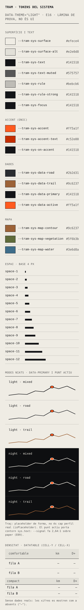
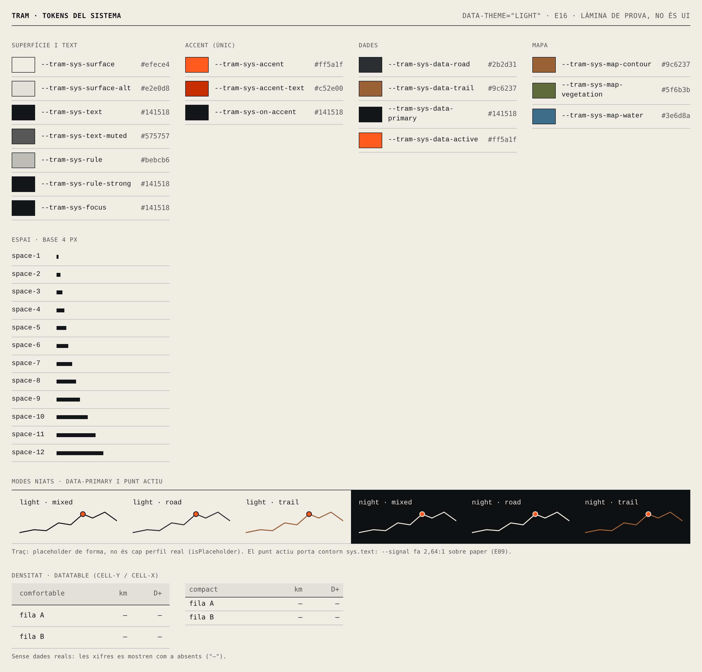
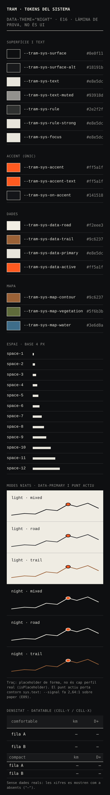
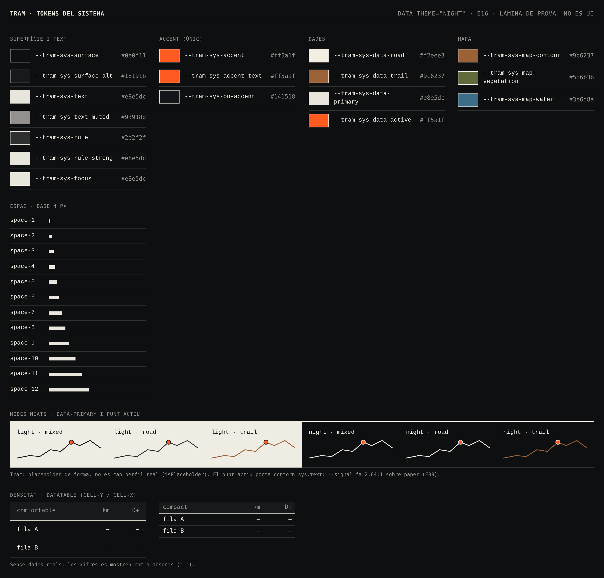

# E16 · Eina de generació de tokens

**Estat:** tancada · **Data:** 2026-11-09 · **Decisió:** opció (b), un script propi en TypeScript

## Pregunta

Com es generen els quatre destins (CSS, tema ECharts, constants Three.js, estils OG) a partir de tokens DTCG, amb tres eixos de mode (tema, terreny i densitat), errors clars i sense degradar el rendiment?

## Context

- El format font és **DTCG 2025.10** (versió estable): colors com a objecte `{colorSpace, components, hex}`, dimensions com a `{value, unit}` i `$root` per tenir un token i un grup amb el mateix nom (`sys.text` i `sys.text.muted`).
- El conjunt de prova són els tokens reals de color i d'espai de la Fase 0: 30 de `ref` i 32 de `sys`. La paleta és la de la secció 7.3, més set colors derivats per contrast, marcats com a `hypothesis` per validar a E09.
- Modes: `theme` (light/night), `terrain` (mixed/road/trail) i `density` (comfortable/compact). En total, 12 combinacions.

## Opcions provades

| | (a) Style Dictionary 5.8.0 | (b) Script propi (TS, Node 22 natiu) | (c) Combinació |
|---|---|---|---|
| Implementació | Prototip amb `css/variables` i `outputReferences`, un build per mode | `packages/design-system/build/` | No s'ha prototipat: vegeu la conclusió |

## Mesures

Màquina: contenidor de CI Linux, Node 22.23. Mitjanes de 3 a 5 execucions.

| Criteri | (a) Style Dictionary 5.8 | (b) Script propi |
|---|---|---|
| Temps de build (dins del procés) | **~97 ms** per a 3 dels 6 contextos, i només CSS | **~13 ms** per a tots els modes i els 4 destins |
| Temps total (`node …`) | ~240 ms | ~100 ms |
| Dependències | 82 paquets, **63 MB** a `node_modules` | **0** en execució (només `typescript` i `@types/node` en dev) |
| Suport de DTCG 2025.10: colors i dimensions com a objecte | Sí | Sí, i a més comprova que `hex` coincideix amb `components` |
| Suport de `$root` | **No**: `{sys.text}` → "tries to reference {sys.text}, which is not defined". Cal escriure `{sys.text.$root}` | Sí |
| `$description` al nivell superior del fitxer | **Falsa col·lisió** ("Collision detected at: !") | S'ignora, com marca l'especificació |
| Modes | No en té de natius. Un build per mode: o es torna a emetre tot el conjunt (4,5–5 KB per mode), o s'emeten només els tokens sobreescrits i els àlies queden **congelats** (vegeu més avall) | Natius: `tokens/modes.json`, amb una estratègia per modificador |
| CSS amb tots els modes | 14,3 KB per a només 3 contextos | **3,7 KB (846 B gzip)** per a les 12 combinacions |
| Nous destins (ECharts, Three, OG) | Formats personalitzats igualment (`registerFormat`) | Una funció per destí, d'unes 40 a 70 línies cadascuna |
| Regles de capa (ref → sys → comp) | No | Sí: error si `sys` té un valor cru, si `comp` apunta a `ref`, etc. |
| Contrast verificat en build | No | Sí, en les 12 combinacions, amb nivells `error` i `warn` |
| Qualitat dels errors | Bona en referències trencades, però sense fitxer ni suggeriment | Fitxer, token, mode i suggeriment ("Did you mean {ref.paper}?"). Es mostren tots els errors alhora |
| Codi propi a mantenir | Config + formats + validacions (estimat > 400 línies, que se sumen a la dependència) | 1.185 línies de build + 370 de tests (31 tests) |

### La troballa clau: herència de custom properties i modes niats

Una custom property CSS que conté un `var()` es resol **a l'element on es declara**, no on s'utilitza. Si els modes es generen com a blocs `[data-theme="night"]` que només sobreescriuen els tokens que canvien, qualsevol àlies declarat a `:root` queda congelat amb el valor del mode clar:

```css
:root { --tram-sys-text: #141518; --tram-sys-focus: var(--tram-sys-text); }
[data-theme="night"] { --tram-sys-text: #e8e5dc; }
/* dins de [data-theme="night"], --tram-sys-focus continua sent #141518 */
```

Ho he comprovat a Chromium: dins de la secció nit, `focus` dona `rgb(20, 21, 24)` en lloc de `rgb(232, 229, 220)`. És el que genera Style Dictionary si es filtren els tokens per mode. L'alternativa, tornar-ho a emetre tot per a cada mode, multiplica el CSS i no resol la combinació tema × terreny quan els atributs són en elements diferents.

**Solució implementada a (b):**

1. **Tema → `light-dark()` + `color-scheme`.** Cada color que varia amb el tema s'emet com a `light-dark(var(--ref-clar), var(--ref-nit))`. `[data-theme]` només canvia `color-scheme`. Com que una custom property no registrada guarda `light-dark()` sense resoldre, el color es decideix **a l'element que l'utilitza**. Per això el tema es pot niar a qualsevol profunditat i combinar amb el terreny en qualsevol ordre. A més, sense `data-theme` es respecta la preferència del sistema operatiu.
2. **Terreny i densitat → atribut.** Cada context (inclòs el de per defecte, perquè un `mixed` niat dins de `road` el restableixi) torna a declarar tots els tokens que en depenen, també els que hi depenen només a través d'àlies.
3. **Regla validada en build:** un token pot dependre com a màxim d'un modificador d'atribut, i el modificador de tema només pot canviar colors. Si es vol trencar aquesta regla, la build falla amb un missatge que explica com dividir el rol.

`test/modes.browser.test.ts` ho comprova a Chromium amb 9 casos niats: nit > trail > clar, road > nit, compact > comfortable, preferència del sistema, etc.

**Suport de navegadors:** `light-dark()` funciona a Chrome 123, Firefox 120 i Safari 17.5 (maig de 2024). Entra dins dels dispositius de referència (secció 10). Falta verificar-ho a WebKit i Firefox reals quan es munti la matriu de E04.

## Captures

Làmina de prova (no és UI de producte) generada amb `pnpm --filter @tram/design-system tokens:proof`:

| | 390 px | 1440 px |
|---|---|---|
| Clar |  |  |
| Nit |  |  |

Observacions de les captures (per a E09):
- **`data-road` i `data-primary` (mixt) gairebé no es distingeixen:** #2b2d31 contra #141518 en clar, i #f2eee3 contra #e8e5dc en nit. És una confirmació visual de 7.3: asfalt i trail s'han de diferenciar per patró (traç continu o discontinu, trama), no per color. Els components de dades ho han de garantir.
- **`--signal` sobre `--paper` fa 2,64:1.** Queda per sota del 3:1 de WCAG 1.4.11 per a elements gràfics i lluny del 4,5:1 per a text. Per això:
  - `sys.accent-text` fa servir `ref.signal-ink` (#c52e00, 4,72:1) per a text sobre paper. De nit, `--signal` ja arriba a 6,15:1.
  - El punt actiu (`sys.data-active`) ha de portar un contorn `sys.text`. La build en mostra un avís perquè no quedi oblidat fins que E09 ho tanqui.
- Els colors derivats (`ink-muted`, `paper-shade`, `paper-rule`, `carbon`, `night-rule`, `night-text-muted`, `signal-ink`) surten de barreges OKLab a partir de la paleta 7.3. La derivació és al `$extensions.com.tramrun` de cada token.

## Recomanació

**Opció (b): script propi**, per tres motius mesurats:

1. **Els modes niats són correctes només amb (b).** Style Dictionary no té cap model de modes, i les dues maneres d'adaptar-lo o bé trenquen els àlies o bé multipliquen el CSS. És el requisit central de 6.2 (un mateix component, bé en tots dos mons i en tots dos temes).
2. **Es valida el que importa a TRAM:** les regles de capa de 6.2, el contrast en les 12 combinacions de modes i el format DTCG 2025.10 complet (`$root`). Amb Style Dictionary, tot això s'hauria d'escriure igualment com a codi propi a sobre.
3. **Cost:** 0 dependències, 7 vegades més ràpid i 1.185 línies tipades i cobertes per tests. Els destins ECharts, Three i OG serien formats propis en qualsevol de les opcions.

L'opció (c) no aporta res: la part que Style Dictionary faria bé (CSS pla) és justament la que el model de modes obliga a fer diferent.

**Riscos i com mitigar-los:**
- *Si l'especificació evoluciona* (per exemple, el mòdul Resolver de DTCG): `tokens/modes.json` en segueix la idea (conjunts + modificadors amb contextos). Si el Resolver s'estabilitza i les eines l'adopten, es pot migrar el manifest sense tocar els tokens.
- *Tipus nous* (tipografia, `strokeStyle`, durades, `cubicBezier`, ombres prohibides): cada tipus nou necessita un parser a `load.ts` i un emissor per destí. És feina prevista per a la resta de la Fase 0.

## Com es fa servir

```sh
pnpm tokens:build     # regenera packages/design-system/dist/
pnpm tokens:check     # CI: falla si dist/ no coincideix amb tokens/
pnpm --filter @tram/design-system test          # 39 tests unitaris
pnpm --filter @tram/design-system test:browser  # modes niats i rols tipogràfics a Chromium
```

## Pendent (fora de l'abast d'E16)

- Gruixos de línia, radis (0 i 2 px), moviment, capes, breakpoints. El tema ECharts encara no fixa el radi del tooltip. La tipografia ja és a la pipeline (E08).
- Regles de Stylelint i ESLint (6.6).
- Catàleg `/ds/` i regressió visual (E17). Aquesta làmina de prova és provisional i se substituirà per les fitxes del catàleg.
