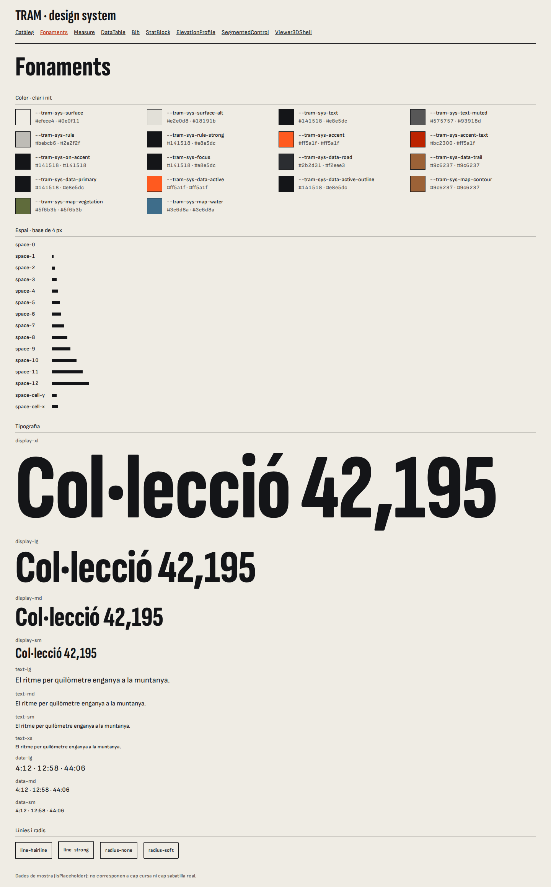
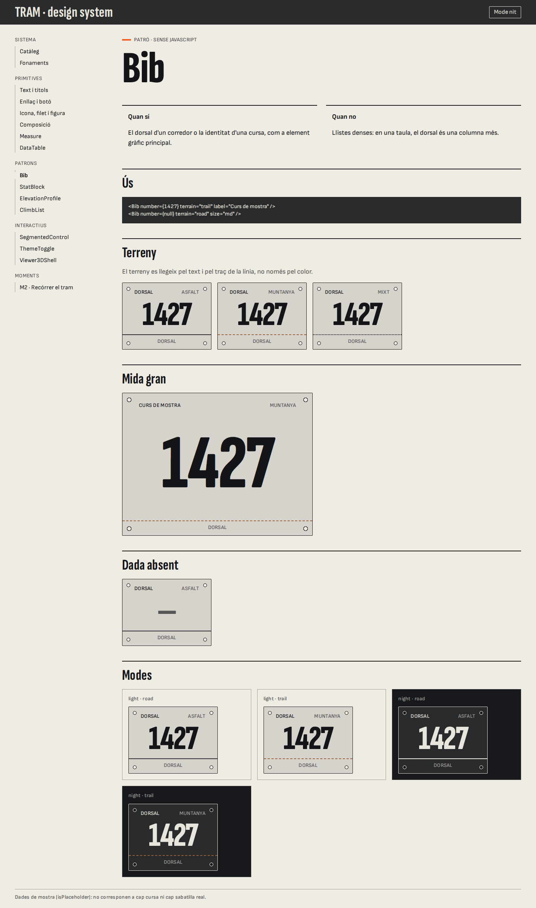
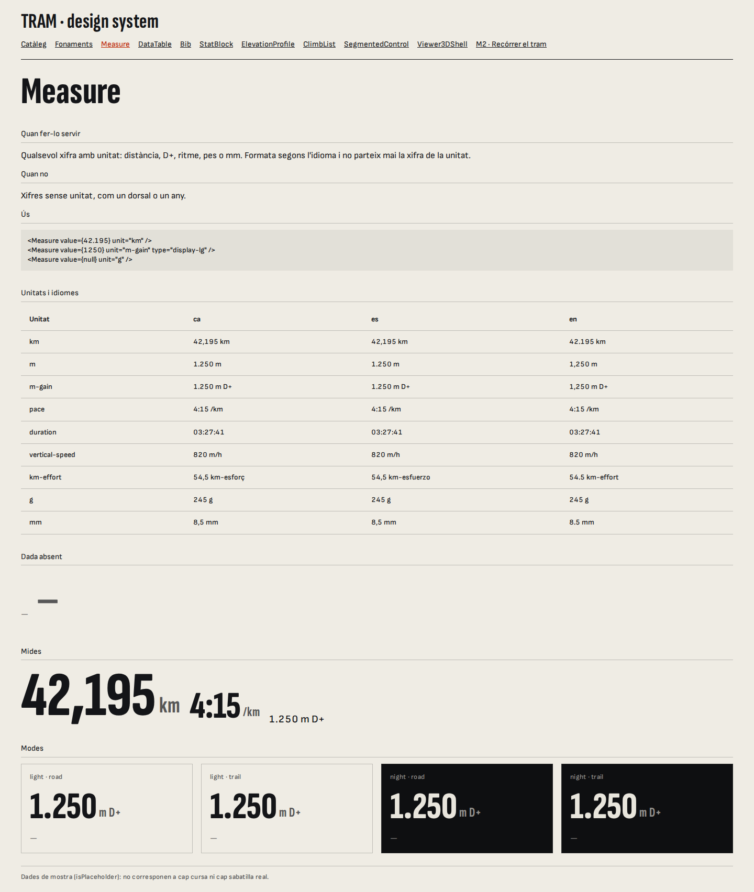
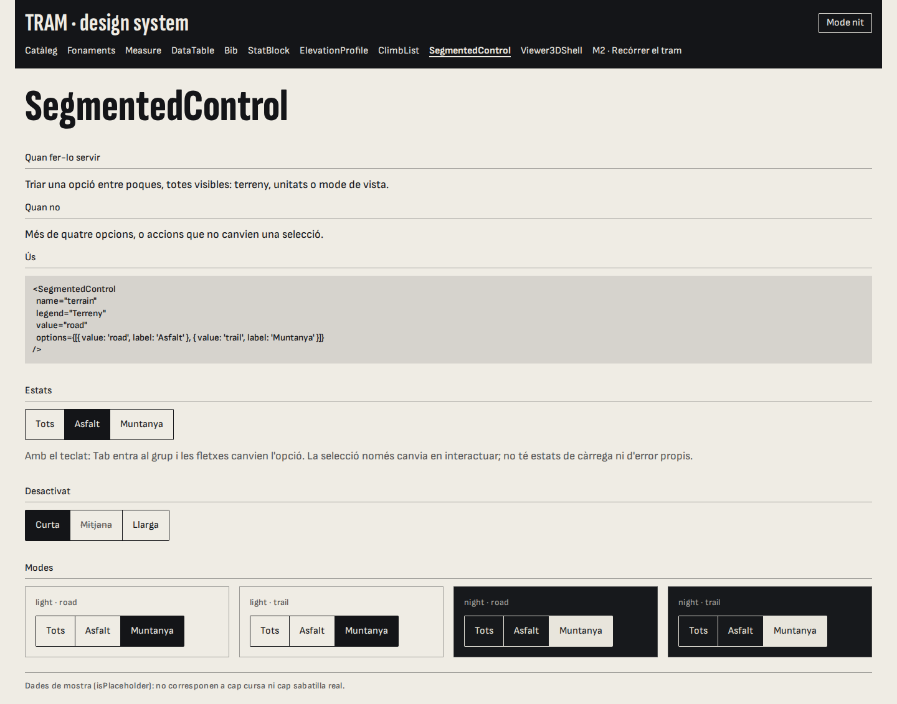
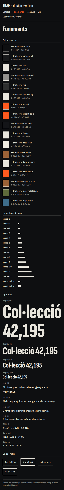
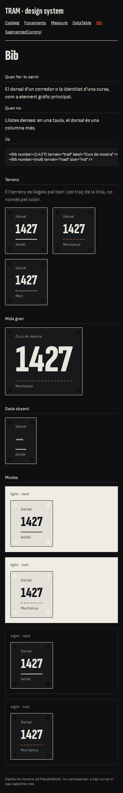
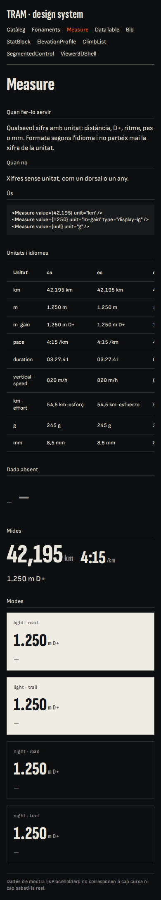
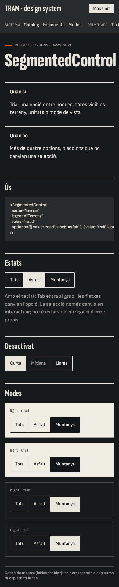

# E17 · Catàleg i regressió visual

**Estat:** implementada i en marxa a GitHub Actions · **Data:** 2026-11-09 · **Recomanació:** catàleg intern `/ds/` amb Astro + Playwright

## Pregunta

N'hi ha prou amb el catàleg intern `/ds/` dins d'Astro, o val la pena una eina com Storybook?

## Context

- **Criteris:** fidelitat (components reals, no còpies), cost de manteniment, velocitat de la regressió a CI i facilitat de revisió per a dissenyadors no tècnics.
- **Lliurable:** catàleg amb els fonaments i tres components complets, un de cada tipus, i la regressió funcionant a CI.

## Opcions

**Storybook amb components `.astro`.** Storybook no té cap framework oficial per a Astro: `@storybook/astro` no existeix a npm. L'opció és `@storybook-astro/framework` 1.15.0, comunitària i activa (última publicació: 2026-11-05), que declara compatibilitat amb Astro 6 i Storybook 10. No s'ha prototipat: s'ha mesurat el cost d'instal·lació i s'ha comprovat l'estat del suport.

**Catàleg intern.** Una ruta `/ds/` dins de l'app, implementada i mesurada.

## Mesures

Mac amb Apple Silicon. La regressió s'ha executat a la imatge `mcr.microsoft.com/playwright:v1.63.0-noble`, emulant `linux/amd64`.

| Criteri | Catàleg intern | Storybook comunitari |
|---|---|---|
| Fidelitat | Els `.astro` reals, amb el mateix compilador i la mateixa API de fonts que el web | Depèn d'un framework de tercers; no provat |
| Dependències noves | `@playwright/test` 1.63.0: 28,5 KB, només de desenvolupament (`playwright` ja hi era) | ~95 MB a `node_modules` com a mínim (`storybook` 10.6.6 + framework, sense els peers opcionals) |
| Paquets de primer nivell | 1 | 90 |
| JS afegit a producció | 0: la ruta no es genera | 0 |
| Build del catàleg (5 pàgines) | 7,1 s | no mesurat |
| Regressió | 56 proves, 28 captures, 1,6 min | no mesurat |
| Mida de les captures | 1,8 MB | no mesurat |
| Revisió per a no tècnics | Pàgines estàtiques, però encara sense URL de previsualització | La seva interfície és millor per a això |

**La regressió detecta els canvis de token.** Amb `ref.line.1` canviat temporalment d'1 a 3 px, han fallat les 28 captures i han passat les altres 28 proves, que no comparen imatges.

### Troballes

1. **Les captures depenen del sistema operatiu.** Les fetes a macOS fallarien a la CI de Linux. Per això la CI i la generació local fan servir la mateixa imatge, amb `pnpm --filter @tram/web test:visual:docker` per actualitzar-les.
2. **La regressió és també un control d'integració:** la prova de desbordament va detectar 83 px de més a la fitxa de `Measure` a 390 px.
3. **Una font per defecte feia inestables les captures.** La monoespaiada de sistema dels blocs de `<code>` feia variar l'alçada 1 px per línia: 12 de 150 captures fallaven a Linux. Amb `code { font: inherit }`, 100 de 100 correctes.
4. **Astro pot exposar els tokens de font sense canviar-los:** vegeu E08.

## Components

| Tipus | Component | Decisions |
|---|---|---|
| Primitiu | `Measure` | Formata amb `@tram/formats`; dada absent amb "—" i nom per a lectors de pantalla |
| Domini | `Bib` | El terreny es llegeix pel text i pel traç, no només pel color |
| Interactiu | `SegmentedControl` | Radios natius, sense JS: el teclat i el focus venen del navegador, i no condiciona E10 |

Els estats de càrrega i d'error no s'apliquen a aquests tres components, i la fitxa de `SegmentedControl` ho indica.

## Captures

| | Fonaments | `Bib` | `Measure` | `SegmentedControl` |
|---|---|---|---|---|
| 1440 px, clar |  |  |  |  |
| 390 px, nit |  |  |  |  |

## Recomanació

**Catàleg intern `/ds/` + regressió amb Playwright.**

1. **Fidelitat sense intermediaris:** és el mateix compilador i la mateixa càrrega de fonts que farà servir el producte.
2. **Cost:** un paquet de 28,5 KB davant de ~95 MB i una dependència comunitària del cicle de versions d'Astro.
3. **Regressió ja resolta:** Playwright compara les pàgines reals, sense capa addicional.

**Riscos i com mitigar-los:**
- *Revisió per a no tècnics:* és el criteri on Storybook guanya. Es resol publicant el catàleg en una previsualització protegida.
- *Mesures de Storybook parcials:* si el catàleg creix i cal una interfície de controls, val la pena fer-ne el prototip.

## Pendent

- ~~Veure el job `visual` a GitHub Actions.~~ Fet el 2026-11-10: la primera execució passa, i les captures generades en local amb emulació x86 coincideixen amb les de GitHub. En un Mac de 8 GB, l'emulació pot quedar-se sense memòria: per a les proves de funcionament es pot fer servir `playwright test --ignore-snapshots` sense Docker.
- URL de previsualització del catàleg.
- Regles de Stylelint i ESLint (6.6).
- Resta de components i fonaments de F0: moviment, capes, breakpoints i graella.
- En `astro dev`, `/ds/` es mostra bé però respon amb estat 404, per la configuració i18n amb prefix obligatori. No afecta la build.

## Com es fa servir

```sh
pnpm --filter @tram/web dev                # catàleg a /ds/
pnpm --filter @tram/web test:visual:docker # regressió, a la imatge de la CI
pnpm --filter @tram/web test:visual:docker --update-snapshots # accepta els canvis visuals
```
