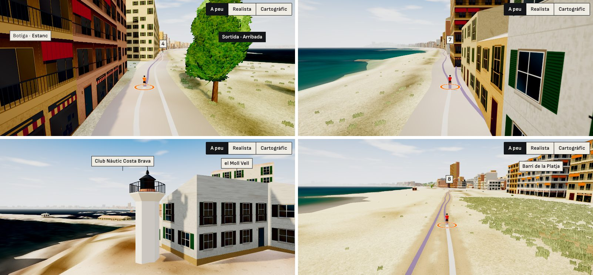
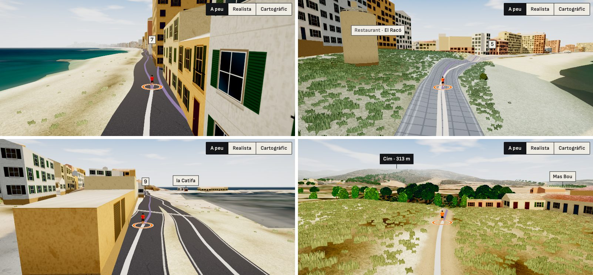
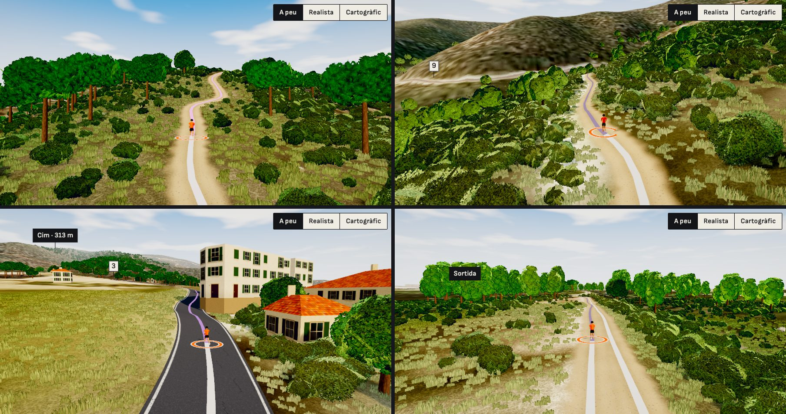
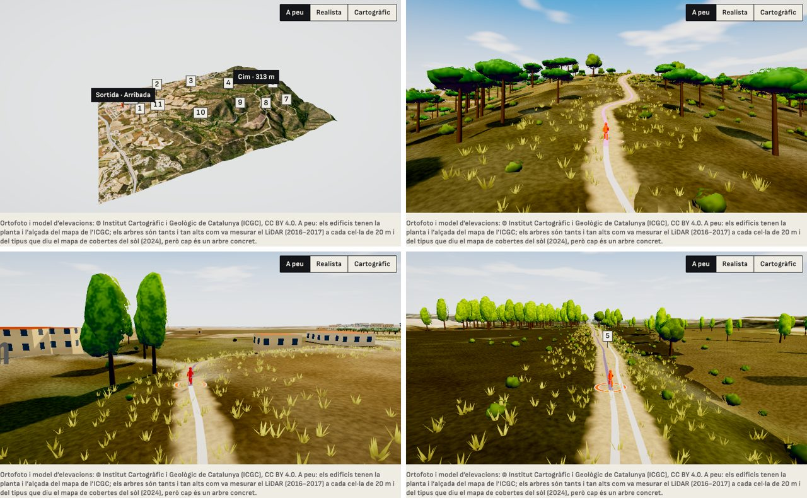

# E18 · El recorregut a peu de ruta

**Estat:** construït com a tercera vista del visor de rutes («A peu»), publicat a l'entorn de proves · **Data:** 2026-11-14 · **Decisió:** escena pròpia en three.js sobre el terreny i l'ortofoto de l'ICGC, amb el que hi ha al llarg de la ruta segons les dades de l'ICGC, del Cadastre i d'OpenStreetMap, sol amb ombres i una càmera de tercera persona

## Pregunta

El visor de rutes pot tenir aspecte de videojoc (arbres, edificis, cel) sense inventar-se el paisatge?

## D'on surt cada cosa

| Element | Font | Què és dada | Què no ho és |
|---|---|---|---|
| Terreny i fotografia | ICGC: model d'elevacions de 5 m i ortofoto | Tot | — |
| Mar | ICGC: on el model d'elevacions no té dada i la terra del costat és a nivell de mar | On hi ha mar, i el seu color (el de l'ortofoto) | El fons (2 m sota l'aigua, perquè la riba s'hi enfonsi), l'onatge |
| Edificis, lluny de la ruta | ICGC: tessel·les vectorials del mapa base (`building`, `render_height`) | La planta de l'illa i la seva alçada | La façana i el color de la paret |
| Cases, a menys de 130 m de la ruta | Cadastre (servei INSPIRE d'edificis): cada part d'edifici amb les seves plantes, l'ús i l'any | La planta de cada casa, les plantes sobre rasant, l'ús (habitatge, comerç, indústria, serveis públics, agrari) | L'alçada (3 m per planta), la façana i el color de la paret |
| Teulades | ICGC: ortofoto | El color, i si és de teula (to càlid) o plana | El pendent i la forma de la teulada |
| Noms de lloc | ICGC: topònims del mapa base (`place`, `landuse`, `mountain_peak`, `water_name`) | El nom, la classe (església, masia, platja, port…) i el punt | L'alçada a què es dibuixa el rètol |
| Bars, comerços, escultures | OpenStreetMap (Overpass), a menys de 35 m de la ruta | El nom, el tipus i el punt | En quina paret hi ha l'aparador: la més propera al punt |
| Arbres de bosc | Variables biofísiques de l'arbrat, LiDAR 2016-2017, cel·les de 20 m: recobriment arbori i alçada mitjana | Quants arbres hi ha a cada cel·la (segons el recobriment) i com són d'alts | On és cada arbre dins la cel·la; la forma de la copa |
| Tipus d'arbre | Mapa de cobertes del sòl 2024 | Si és bosc d'aciculifolis (pi), d'esclerofil·les (alzina, surera), de caducifolis o de ribera | L'espècie concreta |
| Oliverars | Mapa de cobertes del sòl 2024 | On hi ha oliverar | Les fileres (cada 7 m) i l'alçada (4 m): típiques del conreu |
| Arbres de carrer | ICGC: ortofoto (les capes LiDAR d'arbrat no cobreixen els pobles) | Que hi ha copes: on la foto és d'un verd oliva fosc entre cases o en un parc | Quin arbre és (es dibuixen tots caducifolis; les palmeres del passeig no es distingeixen), quants n'hi ha en una filera i l'alçada (9 m, habitual) |
| Any de cada edifici | Cadastre | L'any de construcció | Que un bloc de tres plantes o més fet des de 1955 tingui terrasses de banda a banda: és el que mostren els fronts marítims, no una dada de cada edifici |
| Far de Palamós | Modelat a mà (`three/walk-viewer/landmarks.ts`, `content/landmarks.ts`) a partir de tres fotografies de Wikimedia Commons, que no es reprodueixen | El lloc, l'alçada (10 m) i l'amplada de la balconada (3,6 m), del mapa de l'ICGC; la forma i els colors, de les fotografies | Les mides de cada peça, tretes en proporció de les fotos; la porta, que no en té |
| Platges i passeigs | ICGC: `landcover` (platja) i `transportation` (classe de via) | On hi ha platja; on la ruta va per una via de vianants | El paviment de lloses |

Llicències: ICGC, CC BY 4.0. Cadastre: © Dirección General del Catastro, reutilització amb citació de la font. OpenStreetMap: © col·laboradors d'OpenStreetMap, ODbL (les dades que en surten, dins de `world.json`, porten la marca `o` i queden sota la mateixa llicència). La revisió legal del projecte ha de confirmar-ho abans de producció.

`packages/terrain-pipeline` (`world-cli`) ho baixa un cop per ruta: `world.json` (arbres, edificis i noms), `ortho.webp` (l'ortofoto de tot el terreny, a 2 m per píxel) i `land.png` (el tipus de terra a 4 m per píxel). Tot plegat només es carrega quan es tria la vista «A peu».

| Ruta | Arbres | Edificis | D'aquests, cases del Cadastre | Noms (d'OpenStreetMap) | `world.json` (gzip) |
|---|---|---|---|---|---|
| Calonge | 8.274 | 439 | 231 | 43 (1) | 84 KB |
| Sils | 2.251 | 229 | 140 | 18 (0) | 27 KB |
| Palamós | 361 | 4.807 | 4.374 | 94 (47) | 157 KB |

## Afegir una ruta

Tres ordres sobre el GPX, des de `packages/terrain-pipeline`, i dues línies a `apps/web/src/content` (el perfil i l'entrada de la ruta). Cap retoc a mà de l'escena: Palamós es va afegir així.

1. `pnpm build-route <track.gpx> <carpeta>`: relleu i traçat. Si la ruta toca el mar, les cel·les sense dada passen a ser mar.
2. `pnpm build-plate <carpeta> <km>`: el plànol.
3. `pnpm build-world <carpeta>`: ortofoto, edificis, cadastre, noms, arbres i tipus de terra.

Límits: només Catalunya (les dades són de l'ICGC; el Cadastre cobreix Espanya tret del País Basc i Navarra). El servei del Cadastre triga uns dos minuts per quilòmetre quadrat de poble i a vegades falla: el generador desa cada resposta (`TRAM_WORLD_CACHE`) i demana en quatre trossos el quadrat que no li contesten. Palamós va trigar uns 45 minuts la primera vegada i uns segons les següents. Els servidors d'Overpass sovint estan plens: es proven tres, tres vegades.

Les capes LiDAR arriben com a imatges de grisos que el servei estira de manera diferent a cada petició. El generador pregunta al servei el valor real de dotze píxels, ajusta la recta de gris a valor i falla si no encaixa (0,6 m en alçada, 2,5 punts en recobriment).

## Com es dibuixa

Primer es va provar dins de MapLibre, amb els arbres en una capa pròpia. Funcionava, però MapLibre no deixa fer ombres ni tocar el terra, i es va refer com a escena de three.js (`three/walk-viewer`), amb el mateix `WebGPURenderer` de la vista cartogràfica.

- **Textures**: totes es pinten en un llenç quan arrenca la vista (`textures.ts`): herba, herba seca, fullaraca, terra batuda, asfalt, escorça, teula, una massa de fulles per al cor de les copes, el fullatge de cada tipus d'arbre i una tira de sis panys de paret (finestra amb porticons, balcó, porticons tancats, paret nua, porta i portal de nau). No es baixa cap imatge ni n'hi ha cap de generada per IA.
- **Terra**: la malla del model d'elevacions. **El color és el de l'ortofoto**: un bosc es queda fosc i un rostoll clar. De prop, la textura de cada tipus de terra del mapa de cobertes hi posa el gra que a la fotografia li falta (més clar i més fosc que la seva pròpia mitjana) i una mica del seu color. De lluny és només l'ortofoto. Abans el color era el de la textura, i una màquia densa sortia com un turó d'herba groga.
- **Alçada del terra**: tot el que es posa a terra (camí, plantes, cases) pren l'alçada del mateix triangle de la malla que té a sota. Interpolant entre les quatre cel·les del voltant, el camí quedava un pam enterrat en uns llocs i un pam enlaire en uns altres.
- **Camí i carretera**: el mapa base de l'ICGC diu quins vials són pavimentats. On ho són (un 3 % de Calonge i un 4 % de Sils), asfalt amb les línies blanques; a la resta, terra batuda amb dues roderes i les vores desfetes. Al mig, la línia de la ruta: el que falta, del color del seu pendent; el que s'ha fet, clar.
- **Arbres**: tronc amb escorça, un cor de copa amb fulles i, a sobre, làmines de fullatge repartides per la copa, il·luminades com el volum on són. De prop, més làmines i ombra projectada; de lluny, menys. Les fulles que quedarien a tocar de la càmera es deixen de dibuixar. Una part del seu verd és el de l'ortofoto al lloc on són.
- **Catifa d'herba, matolls i pedres** (`carpet.ts`): de decoració, però posada on toca. Un nombre fix de mates acompanya el corredor, cel·la a cel·la, en lloc de tenir-ne a tota la ruta: així poden ser denses on es veuen (herba fins a 44 m, matolls i pedres fins a 120 m; menys en una pantalla estreta o sense WebGPU). Quantes n'hi ha depèn del tipus de terra del mapa de cobertes i de com de fosca i verda és l'ortofoto en aquell punt: el matollar dens en té moltes, un tros pelat gairebé cap. El que creix a cada cel·la depèn només de la cel·la: tornar a un lloc hi troba les mateixes mates. Prenen el color de l'ortofoto, deixen lliure el camí i no surten dins de cap edifici. A la vora de la catifa s'encongeixen fins a desaparèixer.
- **Cases una a una**: a prop de la ruta, cada illa del mapa de l'ICGC se substitueix per les parts d'edifici que el Cadastre hi té a dins, cadascuna amb les seves plantes. Una illa del passeig de Palamós que abans era una sola paret de 14 m ara són vint cases de dues a set plantes. On dues cases es toquen, la paret mitgera no es dibuixa per sota de la veïna i per sobre queda sense finestres. Cada casa pren un de sis colors de paret (decoració). El que el Cadastre anomena edifici i el mapa no (un moll, una esplanada del port) no es dibuixa.
- **Teulades**: el color és el de l'ortofoto al lloc on és cada teulada. On la foto hi mostra el to càlid de la teula, la casa porta teulada: a quatre aigües amb ràfec i xemeneia si està sola, a dues aigües amb la carena al llarg de la paret més llarga i els testers pujats fins a dalt si està en filera. Si no, terrat pla.
- **Mar**: una làmina a nivell de mar, del color que la foto té a cada punt (les aigües somes clares, el fons fosc), amb ones i lluentor. La platja és la de la foto, sense herba.
- **Noms**: el que el mapa de l'ICGC anomena a menys de 200 m (esglésies, masies, platges, el port, barris) i el que OpenStreetMap anomena a tocar de la ruta (bars, botigues, una farmàcia, escultures) s'escriuen sobre el seu lloc quan el corredor hi és a prop: fins a sis alhora (tres en una pantalla estreta), els més propers i els que el mapa escriu més grossos primer, cap sobre un altre. Davant del nom, la classe de lloc quan el nom no la diu («Església · Sant Antoni», «Restaurant · El Racó»). La paret més propera a cada bar o comerç porta un aparador amb tendal a peu de carrer.
- **Ferm**: on el mapa diu que la via és pavimentada, la banda pren el color que té a l'ortofoto (el gris de l'asfalt, les lloses clares d'un passeig, la sorra daurada d'una plaça), amb el gra d'un ferm vist de prop. Només on la foto és del gris fosc d'una carretera s'hi pinten les línies; on la via és de vianants, les juntes de les lloses. On la ruta passa dues vegades pel mateix carrer (anada i tornada), sense línies, que si no es creuen. Abans tot ferm pavimentat era asfalt negre amb línies blanques, i el passeig de Sant Antoni semblava una carretera.
- **Blocs moderns**: un edifici de tres plantes o més construït des de 1955 (l'any és del Cadastre) porta a cada planta una terrassa de banda a banda, amb la barana i els vidres al fons, una de cada quatre amb el tendal baixat, i comerços a peu de carrer. La resta, finestres amb porticons. Es va decidir mirant el passeig a Google Street View, només com a referència: abans tot el front marítim eren cases de poble amb porticons verds.
- **Arbres de carrer**: un arbre on l'ortofoto mostra el verd oliva fosc d'una copa de diversos píxels, entre cases o en un parc, fora dels edificis i a més de 3,5 m de la ruta. Palamós en té 272, Calonge 443 i Sils 309.
- **Edificis fets a mà**: el far de Palamós, a la Punta des Molí. Ocupa el lloc de l'edifici que el mapa hi té. Des de la ruta, que passa a 135 m, gairebé no es veu: un edifici fet a mà només llueix si la ruta hi passa pel costat.
- **Edificis**: cada mur es talla en panys i plantes sencers, i cada pany de cada planta pren un dels dibuixos de la tira, de manera que cap finestra queda tallada per una cantonada. A peu de carrer, de tant en tant una porta. On el Cadastre diu que l'edifici és industrial o agrari, paret nua amb algun portal; a la resta, finestres. Sense dada del Cadastre, les plantes grans i baixes es prenen per naus. Sota el nivell de planta, un sòcol de pedra.
- **Llum**: un sol de tarda que fa ombres al voltant del corredor (arbres, cases, matolls i pedres), cel amb núvols, boirina amb la distància i una gradació final (més color, to càlid, cantonades més fosques).
- **Càmera**: de tercera persona, 19 m darrere del corredor **seguint el camí** (no en línia recta, que travessaria troncs) i a 5,6 m del terra. En un marc vertical (mòbil) l'angle és més obert. A la sortida i a l'arribada s'enlaira i ensenya tota la ruta.
- **Corredor**: una figura amb samarreta del color de senyal, pantalons curts, sabatilles i cabells. Les cames es dobleguen pel genoll i els braços pel colze, al ritme dels metres recorreguts, sobre un anell del mateix color.
- Els arbres es tallen en trams de ruta i només es dibuixen els propers a la càmera. Dibuixa només quan canvia la posició.

Les rondes anteriors, per comparar:

## Què no s'ha verificat, i límits

- **No és un GTA d'avui, ni el vídeo de referència.** El vídeo «GTA: San Madrid» que es va posar com a objectiu és una animació generada amb IA, no un joc: cada fotograma l'ha pintat un model de vídeo, i això no es pot fer en temps real en un navegador ni sense inventar-se el lloc. El que hi ha s'assembla a un joc de món obert de fa unes quantes generacions: geometria senzilla, textures a tot arreu i vegetació densa a prop. No hi ha cotxes, gent, fanals, bancs, palmeres, rius ni piscines, tanques, murs de pedra ni rètols de carrer (el mapa de l'ICGC porta murs, tanques, piscines i noms de carrer, i encara no es fan servir).
- **Una casa es pot situar, però no reconèixer per la façana.** La planta, les plantes, l'ús i el color de la teulada són de veritat; la façana, les finestres i el color de la paret són decoració. No hi ha cap font oberta amb les façanes de tots els carrers. Només el far de Palamós s'ha modelat a mà; la resta d'edificis emblemàtics es dibuixen com qualsevol altre, amb la seva planta real i el seu nom a sobre.
- **L'alçada de les cases del Cadastre és una estimació**: tres metres per planta. L'alçada mesurada per l'ICGC només es fa servir on el Cadastre no té res.
- **El carrer dibuixat és el traçat del GPS**, no el carrer del mapa: en un passeig la línia fa esses i pot fregar una façana. La càmera passa molt a prop de les parets en un carrer estret.
- **L'ortofoto no és una ortofoto veritable**: un edifici alt hi surt inclinat, i el color d'una teulada es pot llegir uns metres desplaçat.
- **Aparadors i passeigs depenen del que hi ha apuntat**: OpenStreetMap té molts comerços a Palamós, un a Calonge i cap a Sils; el passeig de Palamós només consta com a via de vianants en alguns trams.
- **Més enllà de la catifa el matollar és només la fotografia** sobre el relleu: un vessant a 200 m es veu llis i borrós (l'ortofoto és de 2 m per píxel).
- **On va cada matoll i cada pedra no és cap dada.** La densitat segueix el mapa de cobertes i la fotografia, però és una suposició: el mapa diu «matollar», no quants matolls.
- **El corredor** és una figura articulada de peces arrodonides: no té cara ni roba amb plecs.
- **Cap mòbil real.** S'ha mirat amb la GPU d'aquest Mac (WebGPU), a mida d'escriptori i de mòbil: 60 fotogrames per segon en tots dos casos, també a Palamós amb les seves 4.807 cases. No se sap com va en un telèfon. Per això la vista per defecte continua sent «Realista».
- **Les proves automàtiques** fan servir un renderitzador per programari: comproven que la vista arrenca, quants arbres, cases i noms hi ha, que la catifa es pobla quan el corredor avança i que un nom s'escriu quan s'hi acosta, no com es veu ni a quina velocitat.
- **El LiDAR és del 2016-2017 i la fotografia és posterior**: on s'ha plantat o talat des de llavors, arbres i foto no coincideixen (es veu a les plantacions de Sils).
- **Les capes d'arbrat només cobreixen el bosc**: jardins, arbres de carrer i fruiters no hi surten. Les vinyes es deixen sense ceps.
- **Segons el mapa de l'ICGC, la ruta de Sils només és pavimentada en un 4 %**: la cursa de mostra que hi passa porta l'etiqueta «Asfalt» perquè és inventada, i no s'hi adiu.
- **El corredor de dades** és de 110 m a banda i banda per als arbres, de 260 m per als edificis, de 130 m per a les cases del Cadastre, de 200 m per als noms i de 35 m per als comerços. Més enllà el paisatge és la fotografia sobre el relleu.
- La vista «Cartogràfic» i la «Realista» no tenen arbres ni edificis. Totes dues dibuixen el mar pla: la «Realista» aplana a zero el fons marí que porten les tessel·les de relleu de l'ICGC, que si no deixava la foto de l'aigua penjada de la riba.
