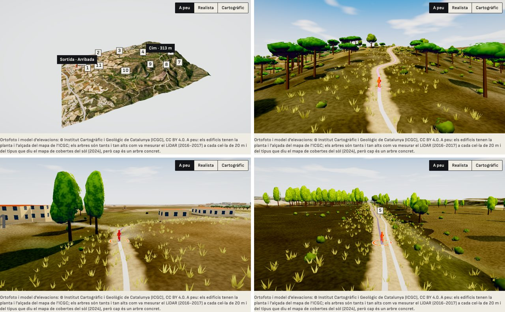

# E18 · El recorregut a peu de ruta

**Estat:** construït com a tercera vista del visor de rutes («A peu»), publicat a l'entorn de proves · **Data:** 2026-11-14 · **Decisió:** escena pròpia en three.js sobre el terreny i l'ortofoto de l'ICGC, amb el que hi ha al llarg de la ruta segons les seves dades, sol amb ombres i una càmera de tercera persona

## Pregunta

El visor de rutes pot tenir aspecte de videojoc (arbres, edificis, cel) sense inventar-se el paisatge?

## D'on surt cada cosa

| Element | Font (ICGC, CC BY 4.0) | Què és dada | Què no ho és |
|---|---|---|---|
| Terreny i fotografia | Model d'elevacions de 5 m i ortofoto | Tot | — |
| Edificis | Tessel·les vectorials del mapa base (`building`, `render_height`) | La planta i l'alçada | El color de la paret i de la teulada |
| Arbres de bosc | Variables biofísiques de l'arbrat, LiDAR 2016-2017, cel·les de 20 m: recobriment arbori i alçada mitjana | Quants arbres hi ha a cada cel·la (segons el recobriment) i com són d'alts | On és cada arbre dins la cel·la; la forma de la copa |
| Tipus d'arbre | Mapa de cobertes del sòl 2024 | Si és bosc d'aciculifolis (pi), d'esclerofil·les (alzina, surera), de caducifolis o de ribera | L'espècie concreta |
| Oliverars | Mapa de cobertes del sòl 2024 | On hi ha oliverar | Les fileres (cada 7 m) i l'alçada (4 m): típiques del conreu |

`packages/terrain-pipeline` (`world-cli`) ho baixa un cop per ruta: `world.json` (arbres i edificis), `ortho.webp` (l'ortofoto de tot el terreny, a 2 m per píxel, uns 600 KB) i `land.png` (el tipus de terra a 4 m per píxel). Calonge té 7.831 arbres (3.541 pins, 2.954 alzines, 81 caducifolis, 1.255 oliveres) i 309 edificis; Sils, 1.942 arbres i 128 edificis. Tot plegat només es carrega quan es tria la vista «A peu».

Les capes LiDAR arriben com a imatges de grisos que el servei estira de manera diferent a cada petició. El generador pregunta al servei el valor real de dotze píxels, ajusta la recta de gris a valor i falla si no encaixa (0,6 m en alçada, 2,5 punts en recobriment).

## Com es dibuixa

Primer es va provar dins de MapLibre, amb els arbres en una capa pròpia. Funcionava, però MapLibre no deixa fer ombres ni tocar el terra, i es va refer com a escena de three.js (`three/walk-viewer`), amb el mateix `WebGPURenderer` de la vista cartogràfica.

- **Terra**: la malla del model d'elevacions amb l'ortofoto. De prop una foto aèria no té gra: fins a uns 200 m de la càmera cada tipus de terra (bosc, matollar, prat, conreu, sòl nu) pren un color i un gra propis, i la foto queda com a matís del lloc. De lluny és només la foto.
- **Camí**: una banda de terra batuda sobre el traçat, que es desfà a les vores, i al mig la línia de la ruta: el que falta, del color del seu pendent; el que s'ha fet, clar.
- **Arbres**: quatre formes (pi, alzina, caducifoli, olivera) fetes de grumolls arrodonits, dibuixades per instàncies. De prop es tallen més fines i fan ombra; de lluny, més gruixudes. La vora de la copa es menja amb un soroll, perquè acabi en fulles i no en una línia.
- **Matolls i herba**: de decoració. Es posen segons el tipus de terra del mapa de cobertes, prop del camí; no surten de cap mesura.
- **Edificis**: murs amb finestres i una teulada (teula a les cases, xapa a les naus grans), a l'alçada del mapa.
- **Llum**: un sol de tarda que fa ombres al voltant del corredor, cel amb núvols, boirina amb la distància i una gradació final (més color, to càlid, cantonades més fosques).
- **Càmera**: de tercera persona, 19 m darrere del corredor **seguint el camí** (no en línia recta, que travessaria troncs) i a 5,6 m del terra. A la sortida i a l'arribada s'enlaira i ensenya tota la ruta, com les altres vistes.
- **Corredor**: una figura a mitja gambada sobre un anell del color de senyal.
- El que creix es talla en trams de ruta i només es dibuixen els propers a la càmera. Dibuixa només quan canvia la posició.

## Què no s'ha verificat, i límits

- **No és Red Dead Redemption.** Té l'estructura d'un joc (tercera persona, ombres, vegetació, cel), però amb formes senzilles: arbres de grumolls, cases de prismes amb finestres pintades, cap animació, cap aigua, cap roca.
- **Cap mòbil real.** S'ha mirat amb la GPU d'aquest Mac (WebGPU) i a mida de mòbil al mateix ordinador. No se sap com va en un telèfon. Per això la vista per defecte continua sent «Realista».
- **Les proves automàtiques** fan servir un renderitzador per programari: comproven que la vista arrenca i quants arbres hi ha, no com es veu ni a quina velocitat.
- **El LiDAR és del 2016-2017 i la fotografia és posterior**: on s'ha plantat o talat des de llavors, arbres i foto no coincideixen (es veu a les plantacions de Sils).
- **Les capes d'arbrat només cobreixen el bosc**: jardins, arbres de carrer i fruiters no hi surten. Les vinyes es deixen sense ceps.
- **El camí es dibuixa sempre de terra**, també on el recorregut va per asfalt: el mapa base de l'ICGC diu si un vial és pavimentat, i encara no es fa servir.
- **El corredor** de dades és de 110 m a banda i banda per als arbres i de 260 m per als edificis; l'herba, a 11 m del camí. Més enllà el paisatge és la fotografia sobre el relleu.
- La vista «Cartogràfic» i la «Realista» no tenen arbres ni edificis.
