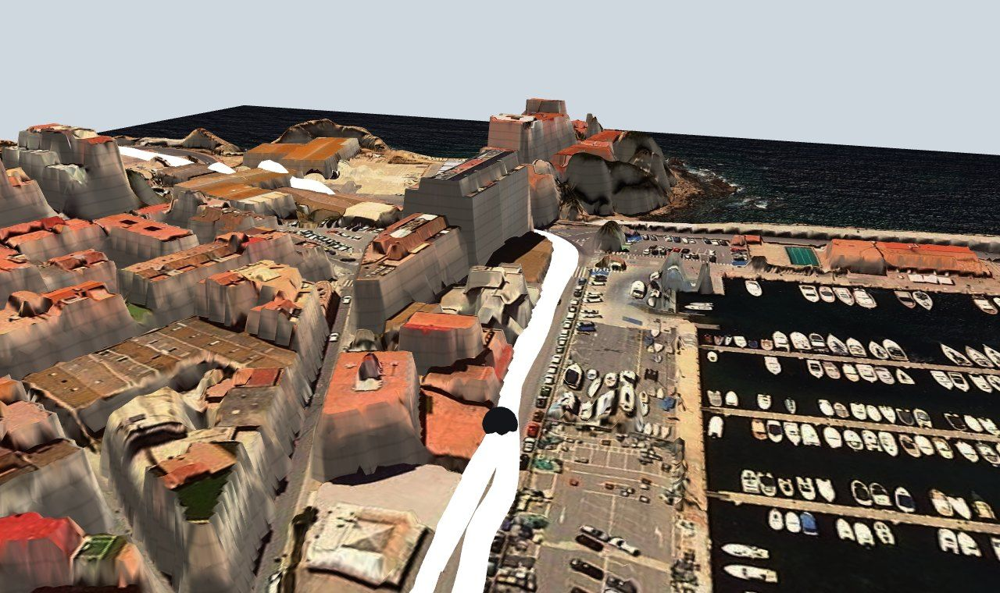
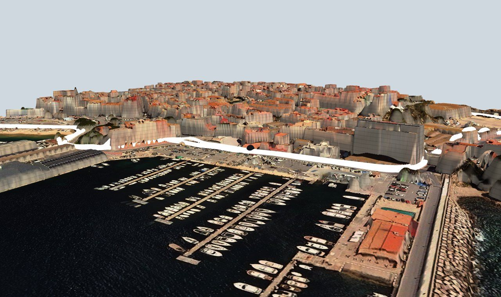
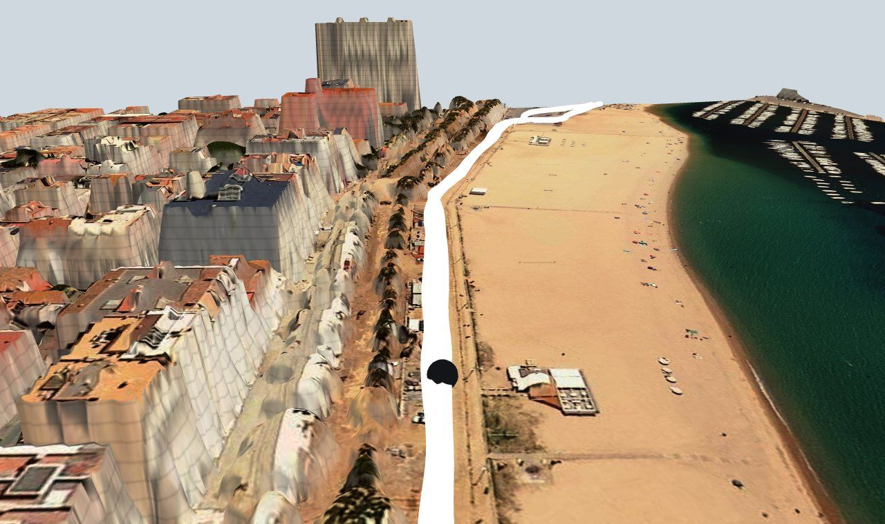
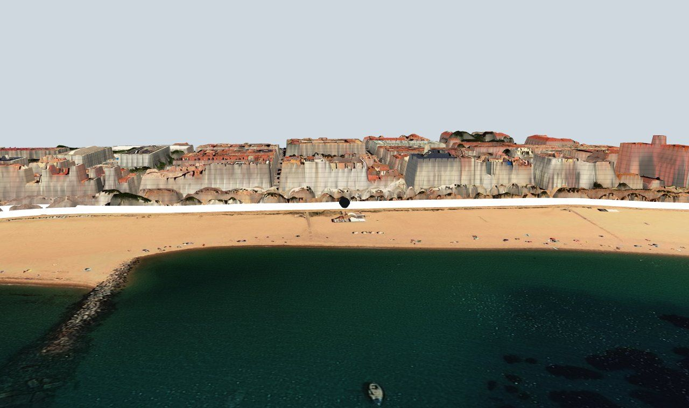
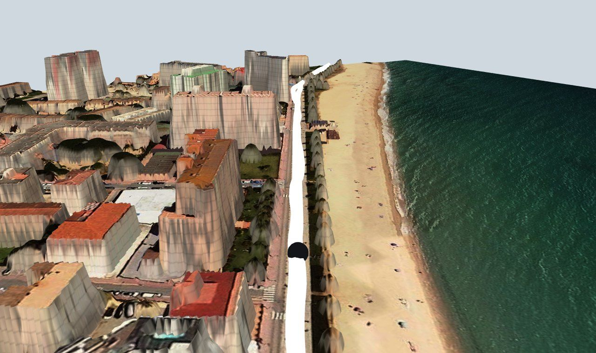
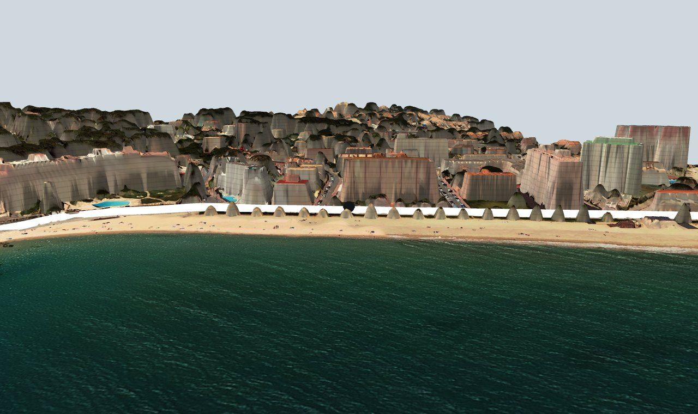

# E20 · El poble reconeixible, amb dades obertes

**Estat:** provat amb un prototip sobre tres llocs de la ruta de Palamós; no integrat al visor · **Data:** 2026-11-20 · **Veredicte:** passa per al mar, la platja i el port; no passa per als edificis

## Pregunta

El titular va trobar que la vista «A peu» (E18) és molt lluny del que es va parlar («estil GTA»): a Palamós no es reconeixen ni els edificis, ni el passeig, ni el mar. Es pot fer reconeixible **gratis**, amb dades obertes, si en lloc de modelar el poble es fotografia des de dalt?

**Criteri de «fet», fixat abans de començar:** tres llocs (passeig, port i Torre Valentina) en què algú de Palamós reconegui el lloc sense llegir cap rètol. Si no hi arriba, es diu i no es fa una segona ronda.

## Què s'ha provat

El que feia Google Earth abans de tenir malles 3D: el **model de superfícies** (el relleu amb els edificis i els arbres a sobre) i l'**ortofoto** posada damunt.

| Peça | Font | Detall |
|---|---|---|
| Relleu amb edificis i arbres | ICGC, model de superfícies LiDAR 2021–2023, CC BY 4.0 | 1 m per cel·la. Un sol fitxer de 104 GB (`datacloud.icgc.cat/datacloud/model-superficies/tif_unzip/`), llegit a trossos amb peticions de rang |
| Fotografia | ICGC, ortofoto vigent (servei WMS del mapa base), CC BY 4.0 | 25 cm per píxel: es veuen les palmeres del passeig, els cotxes i les barques |
| Contorn dels edificis | Els de `world.json` (Cadastre i mapa base de l'ICGC), com a E18 | Només per endreçar: cada edifici pren una sola alçada, la de la seva teulada al model |

El mar no té alçada al model i es posa a zero. Les parets no surten a cap fotografia feta des de dalt: es pinten amb el color esborrat del que tenen a sobre, amb una ratlla tènue cada tres metres perquè l'alçada tingui mesura. **No s'hi dibuixa cap finestra ni cap façana: no se'n sap cap.**

Prototip a [`E20/prototype/`](E20/prototype/): `fetch-dsm.mjs` (llegeix una finestra del model), `fetch-ortho.py` (l'ortofoto), `index.html` (three.js) i `shoot.mjs` (les captures).

## Captures

Tres finestres de 700 m de costat. A cada una, la càmera seguint la ruta a 75 m d'alçada, i una vista des del mar.

| | Seguint la ruta | Des del mar |
|---|---|---|
| Port |  |  |
| Passeig i Platja Gran |  |  |
| Torre Valentina |  |  |

## Mesures

| | Per finestra de 700 m |
|---|---|
| Alçades (490.000 cel·les, sense comprimir) | 1,96 MB |
| Ortofoto a 25 cm (2.800 píxels de costat, JPEG) | 2,3 a 2,8 MB |
| Vèrtexs i triangles | 490.000 i 980.000 |
| Lectura del model de superfícies | Uns segons per finestra |

La ruta de Palamós fa 5,1 km d'anada: cobrir-la demana unes nou finestres, uns 25 MB a 25 cm o uns 7 MB amb l'ortofoto a 50 cm. Cal partir-la en peces i carregar només les properes; no s'ha provat en un telèfon.

## Què es veu, dit sense embuts

- **El mar, la platja i el port són els de debò.** El color de l'aigua, l'espigó, els pantalans amb les barques, la sorra amb la gent i el xiringuito. És el salt més gran respecte a les vistes d'ara, on el mar és una franja de color (i negre, a la vista general de la «Realista»).
- **La forma del poble es reconeix de lluny.** El nucli antic enfilat sobre el port, la primera línia de la Platja Gran, la torre alta, la badia.
- **Els edificis no es reconeixen de prop.** A menys d'uns 150 m són volums grisos amb la teulada bona i les parets inclinades i llises: semblen de cera fosa. Endreçar-los amb el contorn del Cadastre ho millora poc. Un edifici es reconeix per la façana, i la façana no és a cap dada oberta.
- **Els arbres són cons.** Les palmeres del passeig es veuen bé a la fotografia i malament en relleu.

## Veredicte

| Lloc | Es reconeix sense rètol? |
|---|---|
| Port | Sí, des del mar |
| Passeig i Platja Gran | Dubtós: la badia i la platja sí; el passeig i els edificis, no |
| Torre Valentina | No n'estic segur: platja i blocs, sense res que la distingeixi |

**No passa el criteri per als edificis**, que és el que el titular demanava. Sí que dona un mar, una platja i un port reals, que ara no hi són. Qui ha de dir si es reconeix és algú de Palamós: aquesta taula és la lectura de qui ho ha fet.

## Què se'n pot fer

1. **Fer-ne la vista «Realista»**, amb la càmera alta (des del mar o seguint la ruta de lluny), i amagar «A peu». Arregla el mar negre i ensenya el lloc de debò; no promet façanes. Demana partir el terreny en peces i provar-ho en un telèfon.
2. **Provar les tessel·les 3D de Google** dins la seva quota gratuïta (1.000 sessions al mes), que sí que porten façanes fotografiades. Demana un compte del titular amb targeta, i canviar la regla del projecte sobre Google. No s'ha confirmat que cobreixin Palamós.
3. **Deixar-ho aquí.** Amb dades obertes no hi ha més sostre per als edificis: tornar-hi amb una altra ronda de retocs seria repetir el que es va aparcar el 15 de novembre.

## Què se n'ha fet (2026-11-20, mateix dia)

El titular va triar la primera opció i es va muntar al visor de debò, amb el relleu de superfícies en peces prop de la ruta. En veure-ho va dir: **«això no es pot considerar realista»**, i va donar la referència que faltava: **l'app Relive**, que és un vol sobre fotografia de satèl·lit posada damunt del relleu llis, sense edificis aixecats.

- **Els edificis aixecats s'han retirat** abans de publicar-los. No n'ha quedat res al visor ni al repositori, tret d'aquest document i del prototip.
- **La vista «Realista» torna a ser la foto sobre el relleu nu**, amb tres coses noves:
  - **Un vol**: el botó «Fes el vol» recorre la ruta sola en uns 55 segons (`RouteScroller`).
  - **Una càmera que es mou**: es gronxa d'un costat a l'altre del recorregut i s'acosta i s'allunya, en lloc d'anar fixa darrere del corredor. Depèn del quilòmetre, no del rellotge: el mateix lloc es veu sempre igual.
  - **El mar**: on la fotografia és gairebé negra perquè l'aigua és fonda, es tenyeix del color de la seva vora. És una decisió de presentació, no una dada.
- **Lliçó:** un relleu amb edificis que la foto no pot vestir fa pitjor el conjunt que no tenir-ne. Per tenir edificis de debò calen façanes fotografiades, i cap font oberta en té (l'ICGC té imatges de carrer i un bessó digital urbà, però només per consultar-los).

## Què no s'ha provat

- Cap telèfon, ni el rendiment en cap dispositiu que no sigui l'ordinador de proves.
- La ruta sencera: només tres finestres.
- El model de superfícies de costa a 50 cm que l'ICGC anuncia fins a 500 m del mar: s'ha fet servir el d'1 m.
