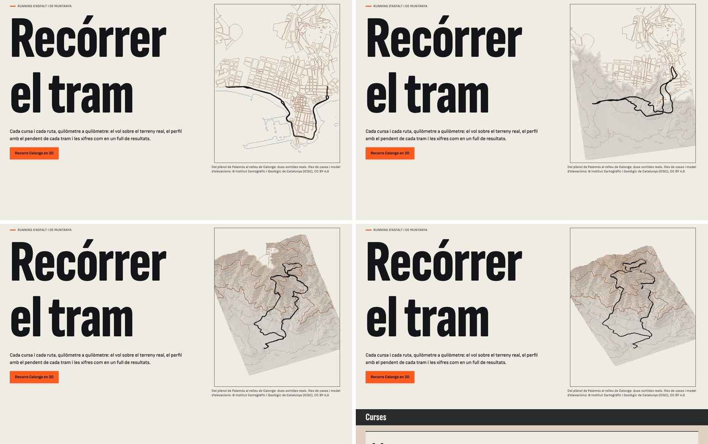

# M1 · De la quadrícula a la corba de nivell

**Estat:** fet, a la portada i al catàleg (`/ds/moments/de-la-quadricula-a-la-corba/`) · **Data:** 2026-11-15

## Què demana el `CLAUDE.md` (7.7)

Un hero que és un terreny en línies i que, en fer scroll, passa d'un plànol urbà (una marató real) al relleu d'una cursa de muntanya real. Primer es carrega un pòster en SVG del primer fotograma, i el 3D s'hi hidrata a sobre.

## Què hi ha

- **Primer fotograma, com a dibuix dins de la pàgina:** el plànol de Palamós en línies. Les illes de cases són les del mapa base de l'ICGC (`illa`), la costa és on s'acaba el seu model d'elevacions, i el recorregut és el tros de la sortida de Palamós que hi passa. El genera `packages/terrain-pipeline` (`build-hero`) a `apps/web/src/content/hero-plan.json`.
- **El pas, en 3D (`apps/web/src/three/hero/scene.ts`):** el plànol es posa sobre el terreny de Calonge a la seva pròpia escala. Amb el scroll, el terreny puja; les corbes de nivell entren de la vall cap amunt i, on han entrat, els carrers se'n van; el recorregut urbà es converteix punt per punt en el de muntanya; i la vista passa de zenital a de costat. Sense perspectiva, com un plànol.
- **La vista es queda quieta** mentre la pàgina avança un 70 % de l'alçada de la pantalla: aquest scroll és el pas. A l'escriptori, el titular s'espera al costat.
- **Amb moviment reduït** queda el dibuix, no es reserva scroll, i el pas es fa amb el botó «Veure en 3D» i les fletxes, un quart cada cop.
- **El 3D es carrega sota demanda**, quan el hero és visible i el navegador està lliure. El JavaScript inicial de la portada continua dins del pressupost.

## Què no és com al document, i límits

- **No és una marató.** El document demana «una marató real» com a plànol urbà; no n'hi ha cap track. Es fa servir la sortida de Palamós, que és urbana i real.
- **Són dos llocs diferents**: Palamós i Calonge. El peu de la vista ho diu. El plànol s'estira 1,6 vegades per ocupar el terreny de Calonge: el pas és entre dues imatges, no un mapa a escala.
- **El gruix de les línies** del dibuix i del 3D no és idèntic (el 3D les fa d'un píxel), i en el moment de carregar-se el 3D es pot notar.
- **Si el 3D carrega quan ja s'ha fet scroll**, apareix al punt on és el scroll, sense passar pel principi.
- **Rendiment:** vist amb la GPU d'aquest Mac, a mida d'escriptori i de mòbil. No mesurat en cap telèfon.
