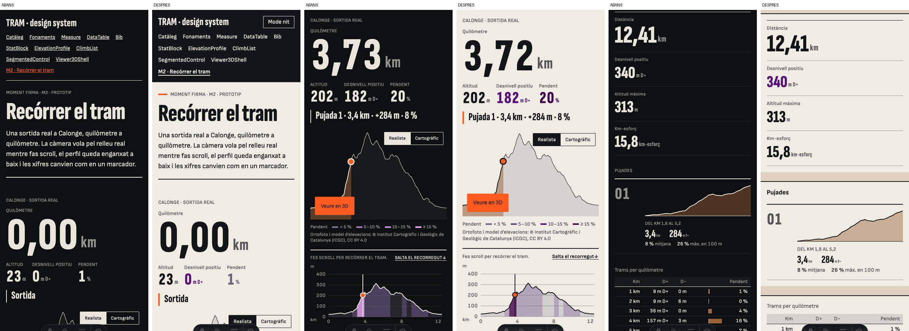
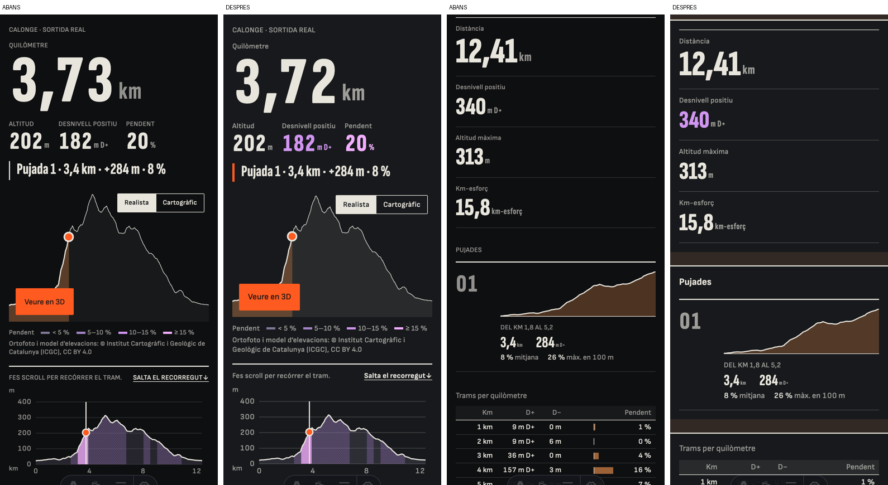
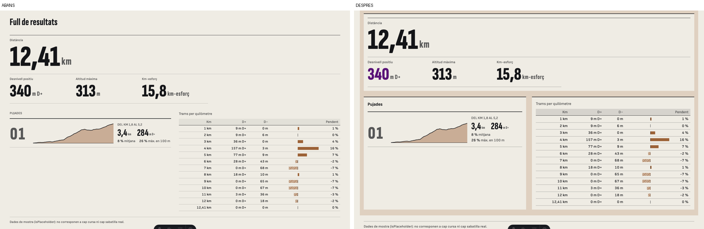
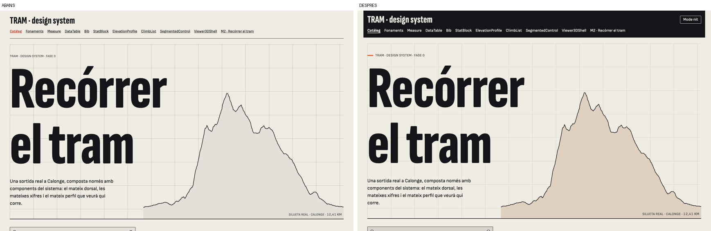

# Segona passada visual: llegibilitat, blocs i color

**Estat:** aplicada, pendent que la torni a jutjar la mateixa gent · **Data:** 2026-11-11

## D'on surt

La gent a qui s'ha ensenyat la web la critica: costa de llegir, els blocs no es diferencien, tot és molt negre i hi ha poc color. Les crítiques es poden mesurar:

| Crítica | Causa | Abans | Ara |
|---|---|---|---|
| Blocs que no es diferencien | Contrast entre el fons i el fons alternatiu | 1,12 (clar) · 1,09 (nit) | 1,27 · 1,22 |
| | Contrast dels filets fins | 1,61 · 1,43 | 2,36 · 2,01 |
| Tot molt negre | El mode nit s'activava sol amb el mòbil en fosc | automàtic | el tria qui llegeix |
| | Fons del mode nit | `#0e0f11` | `#17191c` |
| Poc color | Colors amb paper a la interfície | tinta i taronja | també terra, lila i barres d'accent |
| Costa de llegir | Mida de les etiquetes | de 12 a 14 px | de 13 a 15 px |
| | Textos de M2 en majúscules | 9 (nom, etiquetes del marcador, ajuda, enllaç, avanttítol i títol de bloc) | 2 (nom i avanttítol) |

## Què canvia

1. **Clar per defecte.** Un mòbil en mode fosc ja no porta TRAM a nit: `:root` declara `color-scheme: light` i el tema nit només s'aplica amb `data-theme="night"`. Hi ha un botó "Mode nit" (`ThemeToggle`) que recorda la tria.
2. **Blocs que es veuen.** `Band` és una part de la pàgina de banda a banda, amb el títol sobre una barra de tinta; `Panel` és un bloc pla a sobre, amb un filet fort a dalt. El full de resultats de M2 és una banda tenyida amb tres blocs. La capçalera del catàleg és una barra de tinta.
3. **Més color, amb sentit.**
   - Superfície nova `sys.surface.tint`: paper tenyit de terra (`#dfd0c0`; de nit, `#322824`).
   - El desnivell pren el lila de l'escala de pendent: l'acumulat, i el pendent del moment segons el seu nivell.
   - L'accent taronja marca on comença la pàgina (una barra curta) i la pujada que s'està fent.
4. **Text més gran i menys majúscules.** Tota l'escala de text puja un píxel. Les majúscules queden per al nom del recorregut i els avanttítols.
5. **Mode nit menys negre**, amb superfícies que es distingeixen.

## Abans i després

Un mòbil en mode fosc, a M2 (inici, recorregut i full de resultats):

El mode nit, ara triat a mà:

Escriptori:

## Regles de CLAUDE.md que es relaxen

- **7.3, "únic accent":** el taronja continua sent l'únic accent, però ara també marca l'inici de pàgina i la pujada activa. El color nou ve de la terra i del lila, que ja eren a la paleta o a E09.
- **7.3, mode nit:** deixa de seguir el sistema operatiu i el seu fons s'aclareix.
- **7.4, profunditat amb línies:** es manté (cap ombra, cap targeta arrodonida), però els blocs també es distingeixen pel to del fons.

## Efectes sobre el contrast

Auditoria amb `scripts/color-audit.ts`. La build continua exigint tots els mínims i passa.

- **`ref.signal-ink`: de `#bc2300` a `#b21400`.** L'accent de text no arribava a 4,5:1 sobre les superfícies noves; ara fa 5,94 sobre paper, 4,70 sobre el fons alternatiu i 4,65 sobre el tenyit.
- **Empitjora de nit:** en aclarir el fons, els colors de mapa perden contrast sobre el fons alternatiu de nit: corbes de nivell 2,89, vegetació 2,51 i aigua 2,58 (abans eren per sobre de 3). Sobre el fons de nit principal encara passen (3,54, 3,06 i 3,15), però justos. Caldrien versions de nit d'aquests tres colors.
- Els dos colors tenyits nous queden com a `hypothesis` fins que es validin com a E09.

## Pendent

- **Que ho torni a jutjar la mateixa gent.** És l'única prova que val per a aquesta passada.
- La resta de fitxes del catàleg no s'han refet amb `Band` i `Panel`.
- Tints propis per a asfalt i per a trail: ara el tenyit és un de sol.
- Les captures es van fer en un Mac amb Chromium; no s'ha provat en un mòbil real.
